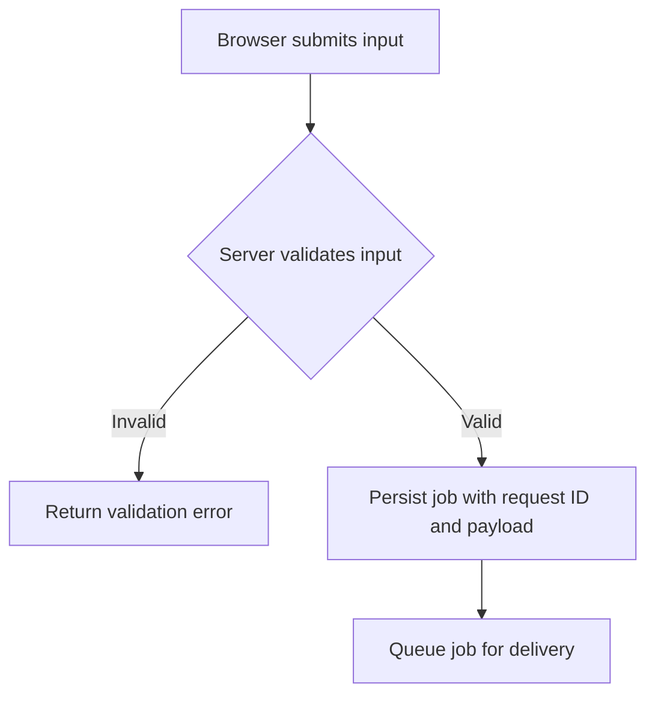
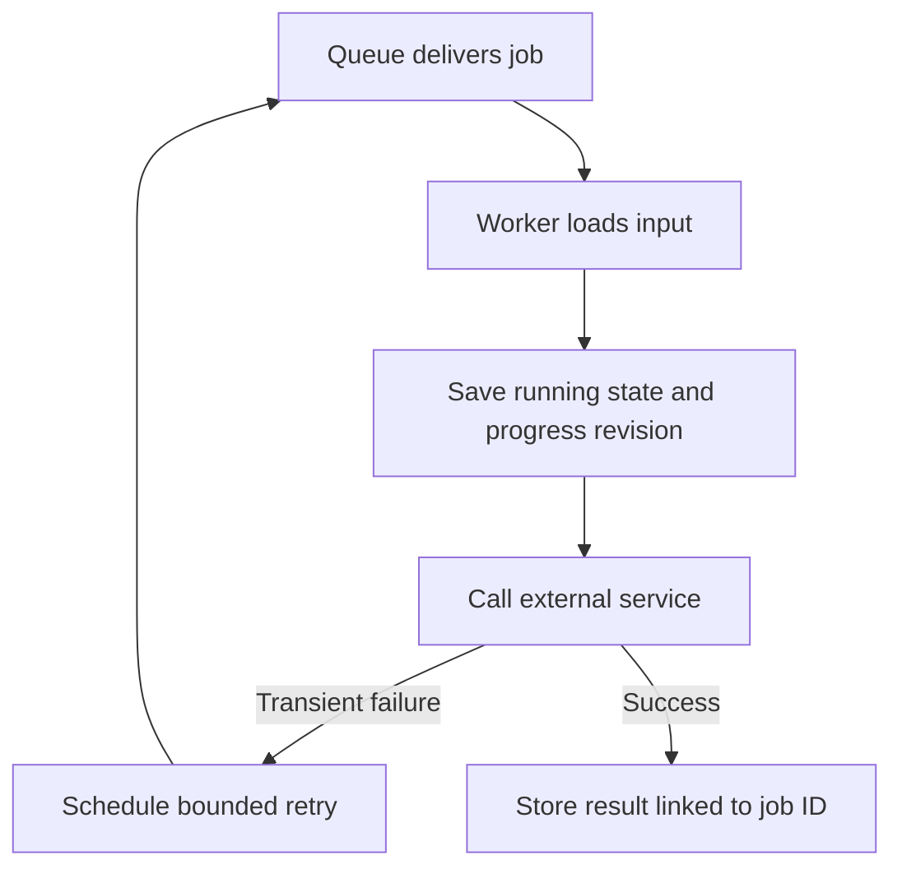
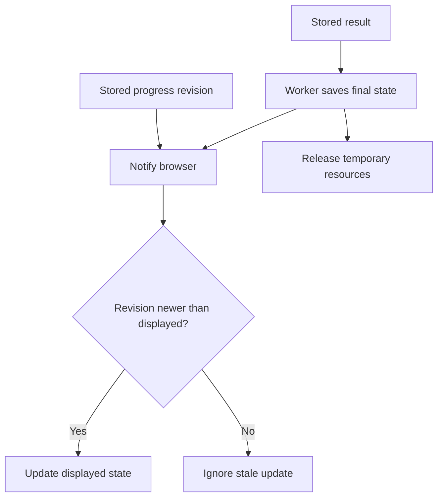

# Diagram selection and readable flows

Choose the representation from the reader's question, the information structure, and the output medium. Do not choose it because a diagram tool is already open. Use the least complicated representation that preserves the truth the reader needs.

Visual grammar should change when the reader's task changes. A sequence diagram makes vertical order mean time. A swimlane makes lane position mean ownership. A state machine makes connections mean legal transitions. A matrix makes row-column intersections mean relationships. A chart can make position, length, area, or width mean quantity. Reusing one box-and-arrow grammar for all of those questions hides meaning instead of clarifying it.

Choose the representation before drawing. Mermaid is useful for small,
structurally regular, auto-layout-tolerant diagrams. Reject Mermaid when two or
more complexity signals appear: roughly 15-20 nodes, 25-30 edges, hubs, more than
two levels of nesting, long labels, many cross-links, exact-placement needs, a
fixed print page, or layout coercion. Also reject it for dense many-to-many maps,
polished audience-facing visuals, or an important relationship with no equivalent
text.

Use tables for compact exact mappings and decision logic. In a PR description,
a diagram supports the product, usage and system explanation. Use ASCII when a
small flow is clear in raw Markdown; use Mermaid or another rendered chart when
layout clarifies branching, sequence or ownership. Neither is a default ban on
the other. Keep both width and height reasonable. Crossing system owners does not
by itself require a rendered chart, and reducing word count does not justify
removing essential causal explanation.

Evaluate each view by what it helps the reader understand, not by diagram count
or format. Avoid wide ASCII canvases and stacks of tall rendered charts. Link a
full architecture or lifecycle view when it would dominate the PR. Choose a custom
composed visual when exact geometry is necessary. Apply the user's current
preference to the current review surface; do not generalize a situational
correction into a permanent format rule.
Always include a textual equivalent for important relationships. Never add
invisible nodes, fake edges, or other semantics solely to coerce auto-layout.

Use diagrams when prose alone would make structure, flow, hierarchy, ownership,
state, or time harder to understand. Choose the medium separately from the job.
The following jobs may need rendered charts rather than ASCII as they grow:

- parser pipelines
- tree and hierarchy layouts
- state transitions
- binary or memory layouts
- algorithm walkthroughs
- edit or event flow
- long lifecycle walkthroughs
- cross-owner handoffs
- stored-state or revision flows
- retry, fallback, cleanup, and recovery paths

Do not add diagrams for simple one-step logic or tiny APIs.

Do not overcompress a diagram when the missing detail is what makes the system
hard to understand. A compact diagram is useful only when it preserves the real
sequence, ownership, state changes, and important branches. Prefer focused
rendered charts for successive stages when a tiny pipeline hides why the system
behaves the way it does.

Always pair a diagram with prose that explains:
- what the reader is looking at
- why it matters
- how to read it
- which details are intentionally omitted

A useful diagram is a reasoning tool, not decoration. It should help the reader
answer questions such as:
- what starts this flow?
- what happens next?
- who owns this step?
- what data or state crosses this handoff?
- what can branch, race, fail, retry, or be cleaned up?
- what stored state prevents stale or out-of-order work from winning?

## Choose the right diagram job

Choose one primary job before drawing:

| Diagram job | Use when the reader needs to understand |
| --- | --- |
| Concept map | The important nouns and how they relate. |
| Component map | Which modules, services, runtimes, or UI regions own behavior. |
| Data flow | How a shape changes as it moves through stages. |
| Sequence diagram | Ordered interaction between a small set of participants. |
| Swimlane | Which owner is responsible for each stage in a workflow. |
| Lifecycle walkthrough | What happens over time from trigger to cleanup. |
| State machine | Which states exist and which transitions are legal. |
| Decision table | Exact combinations of conditions and outcomes. |
| Matrix | Pairwise relationships or classifications across two dimensions. |
| Failure path | How retries, fallbacks, cancellation, and recovery work. |
| Storage or revision flow | How persisted state is written, compared, invalidated, or read. |
| Timeline | When events occur and the elapsed distance between them. |
| Quantitative chart | Magnitude, change, distribution, uncertainty, or comparison where geometry encodes values. |

Do not use a component map when the real question is lifecycle order. Do not use
a one-line data pipeline when the real question is ownership, concurrency,
storage, or cleanup.

## Start simple, then show the operational detail

For architecture explanations, start with a short plain-English story before the
full diagram. The short story gives the reader a mental model. The detailed
diagram then shows the operational truth.

```text
Plain story:
  user action
    -> request validated
    -> work scheduled
    -> worker produces result
    -> state stored
    -> client updates
```

Then show enough detail to preserve the behavior that matters. Do not stop at
the plain story when the system's correctness depends on ownership, revisions,
retries, fallback paths, or cleanup.

## Long lifecycle walkthroughs

Use lifecycle walkthroughs when a system is hard to understand because several
steps happen over time, across owners, or through stored state. These diagrams
are especially useful for workflows with retries, queues, background work,
streaming updates, cleanup, persistence, cross-context handoffs, or user-visible
state changes.

Prefer top-to-bottom time flow. For long diagrams, split the flow into named
chapters instead of drawing one dense box. Each chapter should make the local
story clear before the next chapter starts.

Good chapter labels describe the stage in plain language:

```text
REQUEST RECEIVED
INPUT VALIDATION
QUEUE DISPATCH
WORKER EXECUTION
PARTIAL RESULT STORAGE
CLIENT UPDATE
RETRY OR FALLBACK
FINALIZATION
CLEANUP
```

A useful chapter answers:
- what starts this stage
- who owns this stage
- what data enters
- what data leaves
- what can branch, race, fail, or be retried
- what state is stored, invalidated, or cleaned up

Label ownership contexts at handoff points. Examples include frontend component,
server handler, background job, queue worker, database, cache, browser context,
external service, storage layer, and test harness.

When the handoff contract matters, include a compact representative data shape.
Prefer a small shape that explains the contract over a full interface dump.

After diagrams that introduce project vocabulary, add a short glossary or term
table. Define what each term means in the current system and why it matters for
the flow.

### Detailed lifecycle example

A long lifecycle needs more than a compact ASCII pipeline. This fictional example
uses separate top-to-bottom Mermaid charts for admission, execution, and client
updates. Each view explains one stage without a wide fixed-width canvas.

**Admission:** validate the request before creating a durable job.



**Execution:** the queue delivers at least once. Retry policy and stored progress
must account for repeat delivery; an arrow is not an exactly-once guarantee.



**Client update and cleanup:** the client applies newer stored revisions. The
worker saves final state and releases temporary resources.



The prose preserves the delivery and revision semantics that the simple shapes
cannot prove. A production diagram must verify the actual persistence/queue
handoff and recovery behavior against its source.

## Common diagram shapes

### Pipeline or flow

Use pipeline diagrams when each stage produces a meaningful new shape or
lifecycle state. Do not draw a separate box for every helper function, but do
not collapse away the stage that explains the behavior.

```text
TextSource -> Tokenizer -> Event Stream -> Tree Builder -> Syntax Tree
```

### Tree or hierarchy

```text
root/
├── core/
│   ├── tokenizer.ts
│   └── events.ts
└── ast/
    └── builder.ts
```

### Binary or field layout

```text
Byte:    0       1       2       3
       ┌───────┬───────┬───────────────┐
       │ Flags │ Type  │    Length     │
       └───────┴───────┴───────────────┘
```

### Step-by-step algorithm view

```text
Step 1: tokenize input
Step 2: group tokens into block structure
Step 3: resolve inline structure
Step 4: emit enter/exit/text events
```

### Cross-owner handoff

```text
Client component
  |
  | sends command
  v
Server handler
  |
  | stores durable job
  v
Queue worker
  |
  | writes result
  v
Storage
  |
  | notifies subscriber
  v
Client component
```

## Readability rules

Keep small ASCII diagrams readable in plain text editors and code review diffs.
Use Unicode box drawing only when the target surface renders it clearly.

For larger rendered diagrams:
- prefer top-to-bottom reading on narrow screens
- split major lifecycle stages into focused charts
- keep labels short but specific; explain terminology in nearby prose
- show shapes only at meaningful decisions and handoffs
- explain omitted detail rather than squeezing it into the diagram
- keep branch and merge meanings explicit
- check the target renderer and a narrow viewport when available; record when
  that visual check was not performed

A rendered chart can still be too wide or dense. Do not claim mobile readability
from valid syntax alone. Important meaning must also be available in prose.
