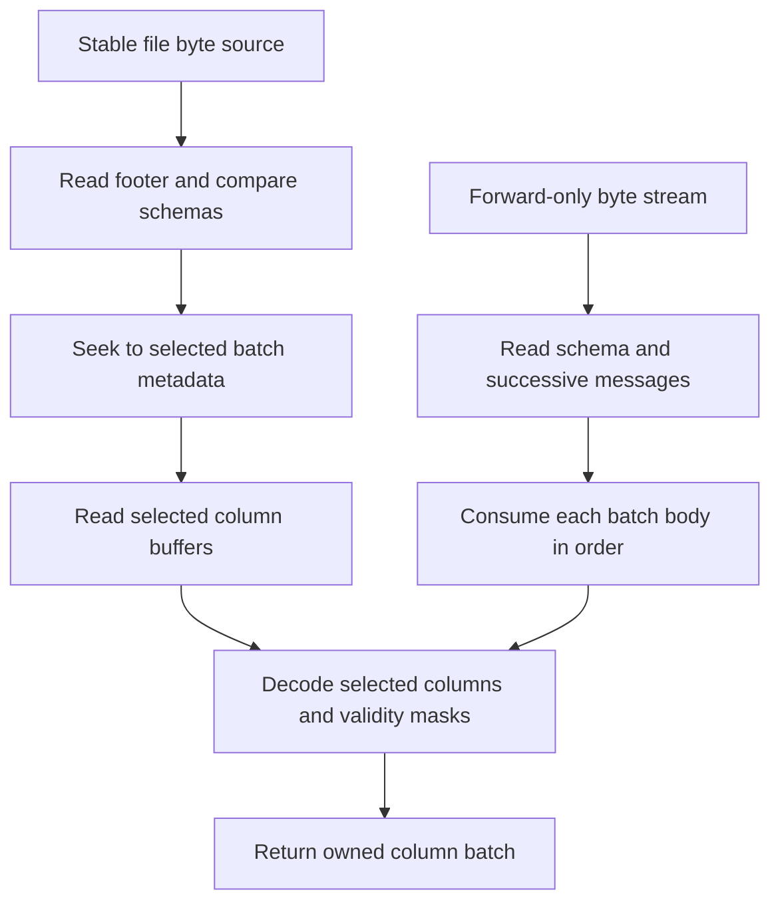

# Preview Arrow columns without loading the dataset

The optional `@okikio/opfs/dataset/arrow` module implements the six-type profile described here. Source and extracted
package checks are separate from publishing a release. Maintainers can use the
[implementation plan](https://github.com/okikio/opfs/blob/codex/release-2026-10-06/planning/storage/ARROW.md) to track
qualification.

An Arrow IPC file stores a schema, record batches and a footer index. A record batch contains equally sized columns. You
can use that index to preview selected columns in the final batch without reading earlier batch payloads. This is a
dataset reader: it does not mount a filesystem or convert Arrow into row objects automatically.

This complete function accepts a caller-supplied `File` or `Blob`, such as a file chosen in a browser. It selects column
ordinals 0 and 4 from the last batch and returns up to 20 display lines. Those columns must have the qualified fixture's
int32 and UTF8 layouts; another dataset can choose different ordinals after inspecting `dataset.columns`.

```ts
import { openArrow } from "@okikio/opfs/dataset/arrow";
import { createBlobSource } from "@okikio/opfs/source";

export async function previewLast(file: Blob, signal?: AbortSignal): Promise<string[]> {
  const dataset = await openArrow(createBlobSource(file), {
    ...(signal === undefined ? {} : { signal }),
    maxSourceBytes: 8 * 1024 * 1024,
    maxRequests: 64,
    maxMetadataBytes: 1024 * 1024,
    maxBufferBytes: 2 * 1024 * 1024,
    maxSelectedBytes: 4 * 1024 * 1024,
    maxOutputBytes: 8 * 1024 * 1024,
    maxRows: 100_000,
  });
  if (dataset.batches.length === 0) return [];
  const batch = await dataset.read(dataset.batches.length - 1, [0, 4], signal === undefined ? {} : { signal });
  const number = batch.columns[0], text = batch.columns[1];
  if (number?.physical !== "int32" || text?.physical !== "utf8") {
    throw new Error("Choose an int32 column and a UTF8 column for this preview.");
  }
  const lines: string[] = [];
  for (let row = 0; row < Math.min(20, batch.rows); row++) {
    const id = number.validity[row] === 1 ? String(number.values[row]) : "<null>";
    const label = text.validity[row] === 1 ? JSON.stringify(text.values[row]) : "<null>";
    lines.push(id + ": " + label);
  }
  console.log({ opening: dataset.work, selection: batch.work, scope: batch.scope, integrity: batch.integrity });
  return lines;
}
```

The validity mask distinguishes null from zero or an empty string. A mask byte of `1` means present; `0` means null. Do
not infer absence from a value slot: null slots contain a canonical zero or empty value. Column ordinals avoid ambiguity
when names repeat or are absent. Returned values and masks own their bytes, so a later read cannot overwrite this
result. Holding the result also retains its storage.

Displaying 20 rows does not limit validation to 20 rows. The reader admits and decodes the complete selected columns in
that record batch before returning them. A large selected string column can therefore exceed the budget even when the
display is small. Selection saves the cost of excluded payloads, rather than making every preview a fixed-size read.

## Choose indexed access or a forward stream



`openArrow(source)` borrows a stable `ByteSourceType`. Opening validates the initial and trailing magic, index extents
and embedded/footer schema agreement. It does not inspect every indexed message, gap or body.
`dataset.read(batch,
ordinals)` then reads that batch's metadata and selected column buffers. It does not read preceding
batch payloads just to reach the last batch. There is no dataset `close()` method: the caller still owns any connection
or file backing the source. A Blob source is immutable; a remote source must provide a genuine stable-revision contract.
An identity string alone does not make changing bytes stable.

`readArrow(stream, options)` follows IPC stream framing rather than seeking. This complete function previews the first
batch, then deliberately stops. It requires the same int32/UTF8 column layout as the file example. Its input must
contain an IPC **stream envelope**. Delivering an IPC file's bytes through a JavaScript ReadableStream does not convert
that file into the IPC stream format; use the indexed reader for that file.

```ts
import { readArrow } from "@okikio/opfs/dataset/arrow";

export async function previewFirst(stream: ReadableStream<Uint8Array>, signal?: AbortSignal): Promise<string[]> {
  for await (
    const batch of readArrow(stream, {
      columns: [0, 4],
      ...(signal === undefined ? {} : { signal }),
      maxSourceBytes: 8 * 1024 * 1024,
      maxOutputBytes: 8 * 1024 * 1024,
    })
  ) {
    const number = batch.columns[0], text = batch.columns[1];
    if (number?.physical !== "int32" || text?.physical !== "utf8") {
      throw new Error("Choose an int32 column and a UTF8 column for this preview.");
    }
    const lines: string[] = [];
    for (let row = 0; row < Math.min(20, batch.rows); row++) {
      const id = number.validity[row] === 1 ? String(number.values[row]) : "<null>";
      const label = text.validity[row] === 1 ? JSON.stringify(text.values[row]) : "<null>";
      lines.push(id + ": " + label);
    }
    console.log({ schema: batch.schema, rows: batch.rows, work: batch.work, integrity: batch.integrity });
    return lines;
  }
  return []; // A schema-only stream has no record batch to preview.
}
```

The generator starts consuming on its first pull. After that transfer, abort, parse failure or early return cancels the
underlying stream and releases its reader lock. Breaking iteration does not leave a resumable stream at the next batch.
By contrast, an indexed reader does not take ownership of its byte source. Keep these two ownership contracts separate.
Cleanup awaits the underlying source's cancellation promise, so a caller-supplied source must settle that promise for
retirement to finish. The default incoming chunk ceiling is 64 KiB. A source producing larger chunks needs explicit
rechunking or a deliberately chosen finite `maxChunkBytes`; a tiny view is copied rather than retaining its large
backing buffer.

A forward reader must consume unselected body bytes before reaching the next message. It materializes a bounded batch,
not an unbounded dataset, but memory still depends on the admitted batch and selected output. Retaining every yielded
batch in an array retains the whole scan's output. Consume and release batches as the application no longer needs them.

The first stream profile accepts modern continuation framing, an explicit end-of-stream marker or clean EOF at a message
boundary. Partial prefixes, metadata, padding or bodies are truncation. Bytes after an explicit end marker are refused.
An early consumer return cannot prove that the unread suffix contains a valid end marker. Neither IPC framing nor this
generator supplies a durable resume checkpoint; reopening and replaying a stable source is a new read.

## Understand what was checked

| Result                                      | Structural validation                                                       | What it does not establish                                              |
| ------------------------------------------- | --------------------------------------------------------------------------- | ----------------------------------------------------------------------- |
| `openArrow`: `scope: "footer-and-schema"`   | Initial/trailing magic, index extents, embedded/footer schema agreement     | Unselected batch messages, gaps and payloads were not all read.         |
| Selected batch: `scope: "selected-columns"` | Batch metadata geometry, selected physical buffers and decoded values/masks | Excluded payloads were not decoded or validated.                        |
| `integrity: "none"`                         | No checksum or authentication claim                                         | Arrow IPC does not authenticate the selected columns or the whole file. |

Structural validity is useful for refusing malformed offsets, invalid UTF8, impossible lengths and inconsistent masks.
It does not prove that bytes came from a trusted author. Transport authentication, immutable source identity and any
external content digest remain the caller's separate responsibilities.

The first profile is uncompressed, V5, little-endian IPC files and modern IPC streams with six flat physical types:
int32, int64, float64, boolean, UTF8 and binary. Int64 values are `bigint` in a `BigInt64Array`. Boolean values are
owned zero/one bytes. Binary columns keep one payload array and an offsets array; consult validity before slicing a
row's bytes. Float64 preserves signed zero and NaN value semantics, without promising NaN payload-bit preservation.
Dictionary, nested, compressed, legacy, big-endian and other physical-type profiles fail explicitly. Selecting only a
supported column does not make an unsupported schema eligible.

Defaults include 8 MiB per footer/message, 64 MiB cumulative source bytes, 4,096 requests and 16 MiB cumulative admitted
output. Batch count is limited to 4,096. The examples deliberately choose smaller source/output allowances. A larger
per-buffer allowance does not bypass a smaller cumulative limit.

Limits are implementation policy rather than Arrow's format maxima. Source bytes and requests account for I/O. Physical
buffer and selected-byte limits bound acquisition. Row counts and output allowances bound materialization. String output
admission includes conservative UTF-16 storage and per-row reference allowances, plus validity masks; it is not an
actual JavaScript heap measurement and does not include every runtime object header. Read `work` as admitted work, not a
benchmark or exact heap-use report. Indexed opening and subsequent reads share their lifetime ledger, so repeated reads
cannot reset the same allowance. A refused operation may already have consumed budget.

On a budget failure, the application can choose a smaller batch/selection, a deliberately larger finite policy, or
another representation. A corrupt or unsupported profile needs a different input or an explicit future capability; do
not skip bytes until a plausible marker appears. Native proof currently uses one pinned Arrow C++ writer and reader
against authored originals. That is independent of candidate serialization, but it is not two-engine interoperability or
proof of every Arrow type. Public runtime, package and benchmark evidence remain separate gates in the plan.
