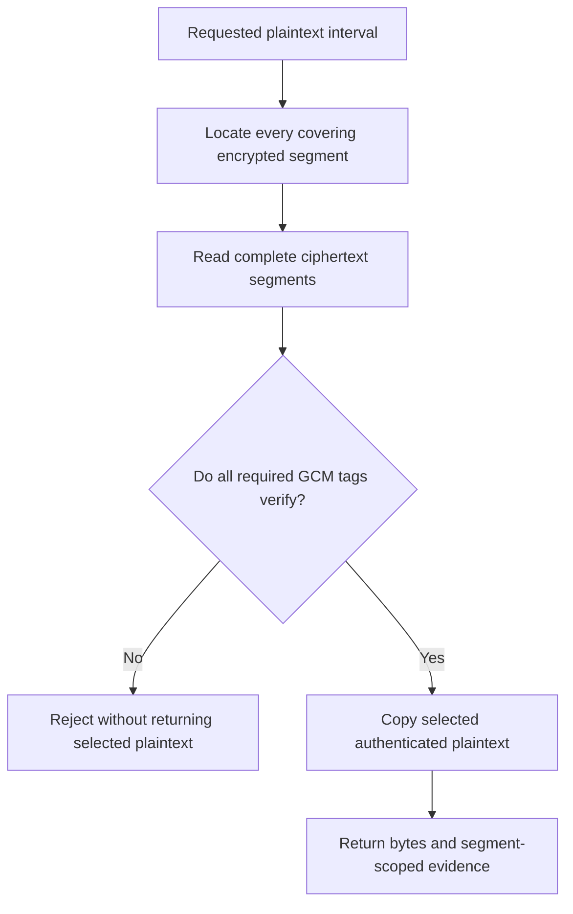

# Authenticate selected encrypted ranges

Encryption hides bytes from readers without the key. Authenticated encryption also detects changes to the encrypted
units it verifies. A preview needs both an addressable layout and a verification boundary: the reader must know which
ciphertext to fetch and how much it must authenticate before releasing the selected plaintext.

That boundary depends on the format. Independently authenticated segments can support bounded selected reads. A format
with one authentication tag for an entire member can require reading that member's complete ciphertext before even a
small preview is trusted. A stream API alone does not remove that requirement. Compression inside encryption can add
another constraint: authenticating a late encrypted segment does not recreate the decompressor state for a compressed
member that began earlier.

`crypto/tink` implements one named payload format: raw AES-GCM-HKDF streaming ciphertext with HKDF-SHA256, a 16-byte GCM
tag, AES-128 or AES-256 derived keys, and zero first-segment offset. It uses native WebCrypto primitives through
injected capabilities. It does not add Tink as a runtime dependency, serialize Tink keysets, implement ZIP passwords or
hide a storage namespace. Store the selected profile parameters and associated data alongside your application's key
policy.

This complete example encrypts a small message and authenticates five selected plaintext bytes. Its final conversion to
a Blob materializes only this tiny example. For large files, pipe the encrypted stream to an admitted streaming sink.

```ts
import { createNativeTink } from "@okikio/opfs/crypto/tink";
import { createBlobSource } from "@okikio/opfs/source";

const profile = createNativeTink();
const key = globalThis.crypto.getRandomValues(new Uint8Array(32));
const associatedData = new TextEncoder().encode("application/document/v1");
const plaintext = createBlobSource(new Blob(["hello encrypted document"]));
const encryptedStream = profile.encrypt(plaintext, key, associatedData);
const ciphertext = new Blob([await new Response(encryptedStream).arrayBuffer()]);

const opened = await profile.open(createBlobSource(ciphertext), key, associatedData);
const preview = await opened.readVerified(0, 5);
console.log(new TextDecoder().decode(preview.bytes)); // hello
console.log(preview.scope); // authenticated-segments

const verified = await opened.verify({ maxCiphertextBytes: ciphertext.size });
console.log(verified.scope); // whole-envelope
```

The key above is high-entropy input for HKDF, the function that derives a separate AES key for each encrypted file. It
is not a password. The application owns its storage, retrieval, access policy and rotation. A new encryption call
obtains fresh salt and nonce-prefix randomness. Reusing an old header or deterministic randomness in production can
reuse a key and nonce, which breaks GCM's security. Test fixture randomness must never be used for real data.

## What a preview verifies

The diagram follows one plaintext interval through this profile. The interval expands to whole encrypted segments before
authentication. Only then is it reduced to the requested output. It omits key derivation and opening's final segment
check, which are described below; each also consumes work.



For a preview UI, show evidence at its real scope. `authenticated-segments` establishes the selected segments, not all
unread middle segments and not the sender's identity. A successful CRC check from an inner ZIP is a separate accidental
corruption check. Neither label is a substitute for a trusted publisher signature.

Opening reads the header and authenticates the final encrypted segment. That confirms the final segment marker and
computed plaintext length before EOF-relative access is allowed. It does not authenticate unchecked middle segments.
Each `read()` or `readVerified()` then reads and authenticates the complete segments covering the requested range. The
operation returns no speculative plaintext if a tag fails. `readVerified()` reports segment count, the first segment and
ciphertext bytes read for that call. `read()` returns the same authenticated bytes without an additional evidence
record. Use `verify()` explicitly to authenticate every segment.

A prefix of 4 KiB can require reading a complete 1 MiB encrypted segment, plus the header and final segment needed
during opening. The selected-read counter excludes work already performed by opening. Compose the encrypted source with
`budgetSource()` and a shared `createSourceBudget()` to enforce aggregate physical bytes and requests across opening,
nested archive access and verification. Do not count only returned plaintext bytes.

An encrypted ZIP can be opened as this authenticated byte source, then passed into `openZip()` from `archive/zip`. The
ZIP reader locates directory/member ranges in the decrypted source; the envelope maps those ranges to complete encrypted
segments. ZIP decompression costs and CRC evidence remain separate from the envelope's GCM authentication. Applications
still own rendering and path projection. This outer encryption does not create a password-compatible ZIP and does not
imply support for encryption inside ZIP entries.

This function previews the first unencrypted ZIP member inside a Tink envelope. The caller supplies the already chosen
key and associated data. A single source budget surrounds the ciphertext, so opening the envelope, locating the ZIP
directory and reading the member share one physical-read allowance. The returned CRC status belongs to the ZIP member;
the outer reader authenticates each encrypted segment used to obtain those bytes.

```ts
import { createNativeTink } from "@okikio/opfs/crypto/tink";
import { budgetSource, createBlobSource, createSourceBudget } from "@okikio/opfs/source";
import { openZip } from "@okikio/opfs/archive/zip";

export async function previewEncryptedZip(
  ciphertext: Blob,
  key: Uint8Array,
  associatedData: Uint8Array,
  signal?: AbortSignal,
) {
  const request = signal === undefined ? {} : { signal };
  const budget = createSourceBudget({ maxBytes: 32 * 1024 * 1024, maxRequests: 128 });
  const source = budgetSource(createBlobSource(ciphertext), budget);
  const plaintext = await createNativeTink().open(source, key, associatedData, request);
  const archive = await openZip(plaintext, {
    ...request,
    maxDirectoryBytes: 2 * 1024 * 1024,
    maxEntries: 10_000,
  });
  const member = archive.entries.find((entry) => entry.kind === "file" && !entry.encrypted);
  if (!member) return null;
  const result = await archive.read(member.id, {
    ...request,
    length: Math.min(4096, member.size),
    maxSourceBytes: 8 * 1024 * 1024,
    maxDecodedBytes: 16 * 1024 * 1024,
  });
  return { name: member.name, ...result, ciphertextWork: budget.inspect() };
}
```

This uses the default Tink profile on both sides. Persist the chosen parameters when encrypting if an application uses
other segment or key sizes. A password-protected ZIP needs its own entry-encryption reader instead: see
[ZipCrypto](password.md) and [WinZip AES](aes.md). Those formats have different security and selected-read boundaries;
changing an import does not make their ciphertext interchangeable.

One preview signal reaches both the envelope's opening reads and ZIP's later selected reads. Tink's `open()` signal
controls opening; it does not become lifetime cancellation authority over the returned plaintext source. Independent
calls to `plaintext.read()`, `readVerified()` or `verify()` must receive their own signal. ZIP forwards its active
signal into the plaintext source when it requests a range. Aborting the preview leaves the Blob and cryptographic
capabilities borrowed; it neither disposes them nor erases the original ciphertext. A new call can reopen that same
snapshot with a new signal and budget. Authentication failure rejects the preview; do not retry it by disabling tag
verification or rendering partially decrypted data.

## Capability and resource ownership

`createNativeTink()` explicitly acquires the host's WebCrypto when called. Importing the module performs no acquisition,
credential discovery or I/O. Use `createTink({ subtle, randomFill, ...options })` to inject a selected cryptographic
provider and cryptographically secure randomness. Both capabilities remain borrowed. There is no global key registry,
automatic download, worker, timer or background cleanup.

Raw input key material is copied before asynchronous derivation so caller mutation cannot change an admitted operation.
Native byte extents authorize key length, associated-data limits and exact source ranges. Caller-owned length, buffer or
offset properties cannot admit a short key, hide an oversized input or change those allocations. A non-extractable HKDF
`CryptoKey` can be supplied as `{ key, size }`, where size is the input key length in bytes declared by its owner.
WebCrypto does not reveal that length for HKDF keys, so the declaration is an assertion, not independently verified key
metadata. The key must be secret HKDF input with `deriveKey` or `deriveBits` usage and adequate input length. An AES-GCM
key cannot be reused as HKDF input. No raw key is written to a checkpoint or log.

All sources are borrowed. They must declare immutable/provider-bound/caller-asserted stability, or the application must
explicitly select `assumeStable`. An identifier alone does not establish consistency. Encryption reads one fixed-size
source incrementally. The output stream pulls no source bytes or entropy before demand; canceling it aborts the work
that stream started through its own signal. Source reads must honor cancellation for prompt retirement. Decryption
operations accept a per-operation `AbortSignal`; they retain no shared mutable decoder state or plaintext cache.

Temporary owned buffers are cleared where possible, but JavaScript, WebCrypto and the runtime can retain other copies.
The package does not guarantee physical memory erasure, constant-time JavaScript control flow, resistance to a
compromised host, or a security audit. Native primitives do not prove that a new composition is secure by themselves.

## Limits and exact profile

| Control                          | Default or constraint                                                     |
| -------------------------------- | ------------------------------------------------------------------------- |
| `segmentBytes`                   | 1 MiB; must exceed header plus 16-byte tag; implementation ceiling 16 MiB |
| `derivedKeyBytes`                | 32; supports exactly 16 or 32                                             |
| `maxReadBytes`                   | 8 MiB returned plaintext per selected range                               |
| `maxSegmentsPerRead`             | 64 complete segments per selected read                                    |
| `maxAssociatedDataBytes`         | 64 KiB copied associated data                                             |
| `maxKeyBytes`                    | 64 KiB raw or declared HKDF input                                         |
| `verify({ maxCiphertextBytes })` | Explicit whole-ciphertext admission ceiling; no unlimited default         |
| Segment count                    | At most 2^32, with safe-integer byte arithmetic                           |

The format permits wider parameter choices than this implementation. SHA1/SHA512 HKDF, nonzero first-segment offsets,
keyset/protobuf parsing and Tink output-prefix variants are unsupported. This profile is not age, secretstream, a
filename-hiding vault or password-derived encryption. It does not supply signatures or sender identity. Associated data
is bound through HKDF and is not stored in the ciphertext. Without the same key, parameters and associated data,
decryption fails; the header is not an automatic format or key-discovery mechanism.

Per-call allocations include selected output, complete ciphertext and plaintext segments, native crypto buffers, copied
key input and associated data. Transport and source implementations can have their own buffering. No hard CPU deadline
is promised. `ciphertextSize()` is a pure size calculation, not I/O or encryption, and does not consume randomness.

## Resume exact ciphertext, not a new encryption attempt

This module does not regenerate a partially uploaded ciphertext after process loss. To resume through `transfer`, save
or otherwise reopen the exact encrypted bytes from that attempt as an immutable replay source. A fresh `encrypt()` call
uses a new header and produces different bytes, even with unchanged plaintext. Never append bytes from a new attempt to
an old upload, reproduce a nonce under changed plaintext, or persist raw keys in a transfer checkpoint.

An opened decrypted source receives a replay identity only if the caller explicitly supplies `identity`. That identity
must bind the ciphertext snapshot, key context, associated data and profile parameters. No automatic identity is
inferred from a bare URL. A source's `stability: "caller"` remains a weaker assertion than provider-bound snapshot
evidence.

## Evidence and remaining review

Fourteen fixtures produced by the official Tink Go v2.9.0 implementation cover both supported AES key lengths, empty
messages, full first/final segments and multiple-segment boundaries. OPFS decrypts them and reproduces their exact bytes
when fixture header randomness is injected. Further tests cover wrong keys/AAD, tampering, every-byte truncation,
segment reordering, finality, cross-realm bytes, HKDF capabilities, read budgets and cancellation. The source checkout's
`tests/fixtures/tink/README.md` records the independent producer and regeneration inputs.

The framing follows
[Google's AES-GCM-HKDF streaming specification](https://developers.google.com/tink/streaming-aead/aes_gcm_hkdf_streaming).
Interoperability tests are evidence for those exact profiles; they are not an independent cryptographic audit, proof of
every runtime, live cloud verification, resumable encrypted writes or a performance result. A security review remains a
release gate for high-assurance deployments.
