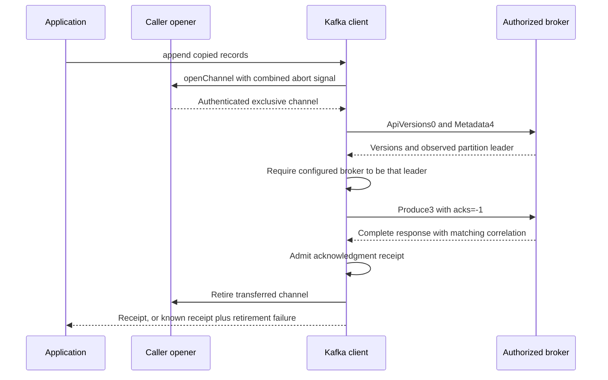
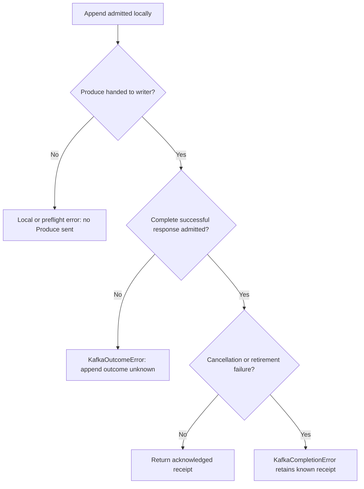

# Append records and read one Kafka partition

Use Kafka when the application needs an ordered retained log: append binary records, save the acknowledged offsets, and
read again from an explicit position. Reading does not remove a record. Broker retention or compaction can remove it
later. The caller selects one topic, partition and broker; this client does not create a topic, join a consumer group or
discover a connection.

The optional `@okikio/opfs/kafka` client implements this explicit-partition profile. Full original-value append/read
comparisons passed in both directions against Apache Kafka's Java client on one disposable plaintext broker. Deno record
and session controls passed separately. The extracted npm package also passed its consumer checks. These results do not
qualify TLS/SASL, multiple brokers or the current commit's CI. [The evidence section](#what-has-independent-evidence)
states the exact scope.

## Supply the connection, then append

The application supplies `openChannel`. It must open a fresh exclusive connection to the authorized broker, verify TLS
and complete any SASL authentication before returning the channel. There is no built-in socket opener or credential
lookup. This complete example composes that capability with one existing partition and appends two records:

```ts
import { KafkaClient } from "@okikio/opfs/kafka";
import type { KafkaChannelType, KafkaReceiptType } from "@okikio/opfs/kafka";

export async function appendEvent(
  openChannel: (options: { readonly signal: AbortSignal }) => Promise<KafkaChannelType>,
): Promise<KafkaReceiptType> {
  const client = new KafkaClient({
    openChannel,
    topic: "owned-events",
    partition: 0,
    brokerId: 1,
    maxBytes: 256 * 1024,
    maxRecords: 100,
  });
  return await client.append([
    {
      timestamp: 1700000000000n,
      key: null,
      value: new Uint8Array([0, 255, 13, 10]),
      headers: [
        { name: "tag", value: new Uint8Array([1]) },
        { name: "tag", value: null },
        { name: "tag", value: new Uint8Array() },
      ],
    },
    {
      timestamp: 1700000000001n,
      key: new Uint8Array(),
      value: null,
      headers: [],
    },
  ]);
}
```

Null and empty bytes remain different values. The first key is null; the second is present with zero bytes. The three
`tag` headers remain ordered duplicates, including their distinct null and empty values. Timestamps are explicit bigint
milliseconds, not implicit clock reads or floating-point conversions. Append copies the input records and nested bytes
before the first asynchronous step, so later caller mutation does not change the dispatched batch.

The returned receipt contains `baseOffset`, `count`, native `logAppendTime` and `throttleMs`. For this two-record
append, the acknowledged offsets are `baseOffset` and `baseOffset + 1n`. Save the receipt before deciding whether to
append more. `logAppendTime === -1n` is the native CreateTime acknowledgment sentinel; a nonnegative value reports the
broker's append time. An acknowledgment with that value does not prove the supplied timestamps survived broker
rewriting.

Every operation opens and retires its own channel. The following sequence shows an append; offset and fetch operations
perform the same version and leader checks before their selected request. Metadata observes the topic without asserting
that its leader will remain unchanged.



The client never dials an advertised hostname or forwards credentials to it. If leadership changes, the call fails. The
application must authorize another broker and supply the corresponding opener before trying another call. Version and
leader preflight are observations on that channel, not a lease on broker state. `metadata()` returns native topic and
partition error codes in its result fields; receiving that observation does not establish that the partition is ready.
The append, offset and fetch preflight refuses those nonzero codes before its selected request.

## Recover from an uncertain append

An append has two different questions: did the broker acknowledge the records, and did this operation retire its channel
successfully? Closing a connection cannot undo a dispatched append. The client records dispatch immediately before
calling the transport writer, including when that foreign call throws.



The native response must be complete, attributable to the selected topic and partition, and valid before it establishes
a successful receipt. A malformed or missing response does not establish that the broker rejected the append.

| Observable result                                          | Established fact                                                               | Caller recovery                                                                                      |
| ---------------------------------------------------------- | ------------------------------------------------------------------------------ | ---------------------------------------------------------------------------------------------------- |
| Ordinary input/acquisition/preflight error before dispatch | This call sent no Produce request                                              | Correct the input or explicitly choose an authorized route                                           |
| `KafkaOutcomeError` with `outcome: "unknown"`              | Produce reached the writer; no admitted successful acknowledgment is available | Reconcile using application record IDs and retained log state before considering another append      |
| `KafkaReceiptType`                                         | A complete successful acknowledgment was admitted and retirement finished      | Retain its offsets and native timestamp evidence                                                     |
| `KafkaCompletionError.receipt` after append                | The acknowledgment is known even though a later abort or retirement failed     | Keep the receipt together with its failure; do not repeat the append merely to obtain a clean return |

A complete nonzero Produce response also results in `KafkaOutcomeError`. Its cause retains the native `KafkaError`,
directly or inside collected failure evidence. Some Kafka errors can occur after a local append, so this first profile
conservatively treats every dispatched nonzero response as unknown. It never retries, including after a timeout or moved
leader.

`KafkaError` exposes `operation`, numeric `code` and an `observation` for a complete native refusal. ApiVersions
failures preserve the decoded version list; offset failures preserve native timestamp/offset; fetch failures preserve
high watermark, last stable offset, record-set state and aborted-transaction observations. A preflight `KafkaError` can
occur before append dispatch and therefore need not be wrapped in `KafkaOutcomeError`. Cleanup may add aggregate failure
evidence.

The client does not log automatically. Its own protocol error messages do not interpolate topic names, broker hosts,
keys or payloads. Native observations can contain broker metadata, and caller-supplied transport errors may contain
their own details. The application chooses what to retain or log; error wrapping does not sanitize foreign causes.

Produce uses `acks=-1`, meaning the broker applies its current all-ISR acknowledgment condition. ISR means replicas
currently considered in sync. This does not promise indefinite retention, disk fsync, exactly-once delivery or more than
one copy in a one-broker fixture.

## Read and retain a cursor

`fetch(offset)` reads one bounded materialized page without changing a broker consumer-group offset. Its cursor is an
offset in this one topic/partition, not a portable position in another log. This complete example reads the earliest
retained position, then one page:

```ts
import { KafkaClient } from "@okikio/opfs/kafka";
import type { KafkaChannelType, KafkaPageType } from "@okikio/opfs/kafka";

export async function readFirstPage(
  openChannel: (options: { readonly signal: AbortSignal }) => Promise<KafkaChannelType>,
): Promise<KafkaPageType> {
  const client = new KafkaClient({
    openChannel,
    topic: "owned-events",
    partition: 0,
    brokerId: 1,
  });
  const earliest = await client.offset("earliest");
  return await client.fetch(earliest.offset);
}
```

These are two separate calls and two fresh connections. Retention or leadership can change between them. After
processing a successful page, the application can persist `page.nextOffset` and later pass it to `fetch()`. The library
does not persist that position or atomically commit it with application side effects. A `KafkaCompletionError` from
fetch retains the known page; the caller decides whether to use it while retaining the cleanup failure.

Each returned record includes its actual bigint `offset` and `timestamp`. Returned key/value/header bytes are separately
owned; they neither alias mutable transport chunks nor retain the whole frame. Duplicate headers stay in order.
`wireRecords`, `recordBytes` and `headers` count the admitted wire page before filtering out offsets below the requested
position.

The parser checks every batch's full CRC32C scope, lengths, counts, offsets, timestamps, supported attributes and
trailing extent before returning any page. CRC32C detects accidental corruption; it authenticates neither the peer nor
the record's meaning. If a later batch fails, the client returns no earlier record prefix and no cursor. A valid CRC
does not excuse malformed lengths or a policy limit. An incomplete final batch refuses the whole page as outside this
profile; Kafka can legitimately return an incomplete tail in other profiles.

Compaction can leave gaps between record offsets or remove every record from a batch. The client therefore advances from
the greatest validated native batch last-offset boundary plus one, never from returned record count. It never regresses
the requested position. An empty compacted batch can advance the cursor; its base-timestamp sentinel `-1n` remains
valid. A batch requiring a successor beyond signed int64 is refused rather than wrapping.

A response with no batches keeps the requested cursor. Fetch's nullable record set can be null or present with zero
bytes: both return an empty page, while `recordsState` preserves `"null"` versus `"present"`. An empty page is a
point-in-time observation, not permanent EOF. It is still possible for a page with no returned records to contain
validated batch boundaries and advance.

`offset("latest")` returns the native consumer high-watermark boundary unchanged; do not add one. A fetch page also
retains its observed `highWatermark` and `lastStableOffset`. These observations are separate from `nextOffset`: they are
not permission to skip unseen batches. The client does not fabricate a log-start offset or leader epoch absent from the
selected response version.

The channel's `ReadableStream<Uint8Array>` carries transport chunks, whose boundaries have no Kafka meaning. Fetch
reassembles protocol frames and returns complete records only after whole-page admission. This is explicit offset-based
recovery, not a resumable upload stream, automatic poll loop or persistent consumer-group session.

## Supported versions and explicit limits

This first profile requires all five fixed classic versions below on each operation's fresh channel. A peer missing any
required version refuses before Produce dispatch. There is no downgrade or flexible-message fallback.

| API         | Version | Scope                                                                            |
| ----------- | ------- | -------------------------------------------------------------------------------- |
| ApiVersions | 0       | Complete bounded capability list, including native error responses               |
| Metadata    | 4       | One named topic, auto-creation disabled; observed broker/leader/replica/ISR data |
| Produce     | 3       | One nonempty uncompressed magic-2 batch, one partition, `acks=-1`                |
| Fetch       | 4       | One partition, read-uncommitted, explicit bigint offset                          |
| ListOffsets | 1       | Consumer earliest/latest special queries, without group commits                  |

Append uses nonnegative explicit CreateTime timestamps and non-idempotent producer/epoch/sequence sentinels `-1`. Fetch
currently accepts only that non-idempotent, uncompressed, nontransactional CreateTime batch profile. In particular, it
refuses records written with idempotent producer state, even when those batches are otherwise uncompressed and
nontransactional. Modern producer SDK defaults can therefore produce batches outside this initial read profile.
Compression, LogAppendTime reads, transactional/control/delete-horizon flags, reserved attributes, old batch magic and
nonminimal varints refuse the complete page. These are client restrictions, not claims that Kafka lacks those features.

| Admission policy                                                                | Default and implementation ceiling   |
| ------------------------------------------------------------------------------- | ------------------------------------ |
| Complete serialized record envelopes, including header names/values and framing | `maxBytes`: 1 MiB across append/page |
| Records before offset filtering                                                 | `maxRecords`: 1024                   |
| Headers in any one record                                                       | `maxRecordHeaders`: 64               |
| Headers across append/page                                                      | `maxHeaders`: 1024                   |
| Record batches in a page                                                        | 1024                                 |
| Request or response body                                                        | 4 MiB                                |
| Whole-call request/response traffic, including preflight                        | 8 MiB                                |
| Retained transport chunk                                                        | 64 KiB                               |

The four record options can lower their ceilings. Bytes/records must stay positive; header limits may be zero. Append
first admits and copies payload/name bytes, then includes framing overhead during encoding. A payload exactly at
`maxBytes` can therefore fail once encoded. A fetch policy overflow rejects the entire wire page before older offsets
are filtered; it does not silently return a smaller page. Broker fetch-size settings remain soft request policy, while
these client ceilings remain hard.

Metadata also has bounded counts: 128 brokers, 1024 partitions, 128 entries per replica/ISR list and 8192 replica/ISR
IDs in aggregate. Classic strings use signed int16 byte lengths and strict UTF8; a literal BOM is preserved. These
source admission limits are not a measured peak-memory claim. Allocation measurements and worst-case retained-memory
qualification remain separate acceptance gates.

The operation deadline defaults to 30 seconds, with a one-day maximum. Channel retirement has an independent five-second
default, with a one-minute maximum; operation cancellation does not skip cleanup. Per-call signals combine with the
client signal and deadline. The opener owns partial or late acquisitions until successful transfer, and must retire them
if cancellation wins. After transfer, the client owns the channel's idempotent `close()`, attempts retirement before
releasing its stream locks, and reports cleanup failures. `allowPlaintext: true` explicitly permits a
caller-authenticated unencrypted channel; it does not establish peer trust or perform authentication.

## What has independent evidence

The [retained native fixtures](../tests/fixtures/kafka/README.md) record Java and authored literal-wire append/read
comparisons, null/empty bytes, duplicate headers, exact timestamps and JDK builtin CRC32C agreement. Separate fresh
Metadata4 qualification compares decoded broker, cluster, leader, replica and ISR observations against the public Java
Admin API. Those fixtures supply independent originals and protocol observations for candidate tests.

The separate 6 November 2026 candidate runs `kafka-candidate-native-v1` and `kafka-candidate-native-v2` exercised the
production client against one fresh Apache Kafka 4.4.0 broker. Java appended three originals and the candidate fetched
them; the candidate appended three originals and Java read them. Complete key/value/header bytes, timestamps and offsets
agreed in both directions, including 128 KiB, null/empty fields and duplicate ordered headers. Both terminal receipts
reported success without operation or cleanup faults. The second run also checked public metadata against the
independent fixture observation and earliest/latest boundaries `0`, `3` and final `6`, with special-query timestamps
`-1`. Those receipts remain local under `.tmp/implementation/`; they do not rewrite historical evidence. A third final
repeat also passed and is retained with full byte hashes, source identities and resource/removal evidence in
[`native-client/`](https://github.com/okikio/opfs/tree/codex/release-2026-10-06/tests/fixtures/kafka/native-client).

Separate isolated Deno `--no-check` runs passed record controls in receipt `df287981-946b-4e64-9580-4c61aae01ca3` and
session/outcome/ownership controls in `2c2faee8-3e80-4129-9c8c-b5f753f9c9ea`. They exercise the portable TypeScript
source; they are not type checks or proof of execution in every supported runtime. TLS/SASL, multiple brokers,
replicated durability, measured allocation peaks and current commit CI remain separate. The
[Kafka plan](https://github.com/okikio/opfs/blob/codex/release-2026-10-06/planning/storage/KAFKA.md) tracks those
boundaries; [the Apache format description](https://kafka.apache.org/44/implementation/message-format/) and retained
primary schemas define the wire layout.

The later combined record/session run passed 52 steps in isolated receipt `d3db3cd4-b0f2-4eda-9bbe-72aba03a717f`.
`deno task bench:kafka` measures full CRC/record admission against an owned-byte copy of the same hash-checked native
page. Fixture I/O and full original-value checks run before sampling. The copy lane omits validation deliberately, so
the comparison describes local parser cost rather than equivalent validation or network throughput. It measures neither
the caller's opener nor broker, TCP, TLS or retention performance.

The extracted npm artifact passed isolated receipt `9dd38c21-13cb-43ea-9176-d67288ddde3a`: public Kafka types, guarded
imports, construction without I/O, cancellation, append and retained known/unknown outcomes. The same packed workflow
ran in Node, Deno and Bun, and optional browser bundling passed. Registry access supplied the existing build/consumer
dependencies; the runner retained its 2 GiB memory/swap and one-CPU limit, with no OOM and completed removal. This is
package-consumer proof, separate from native broker behavior and CI for the pushed commit.

Kafka records remain a log capability. There is no Kafka filesystem driver, adapter, file truncation or filesystem
projection in this slice. Use the [storage model](model.md) when the application needs file/directory semantics instead
of native log offsets and retention.
