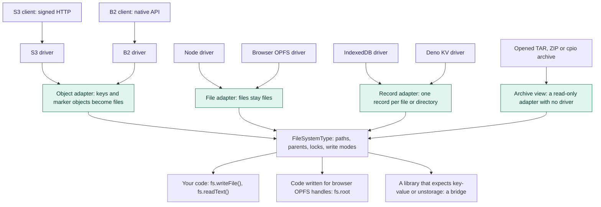
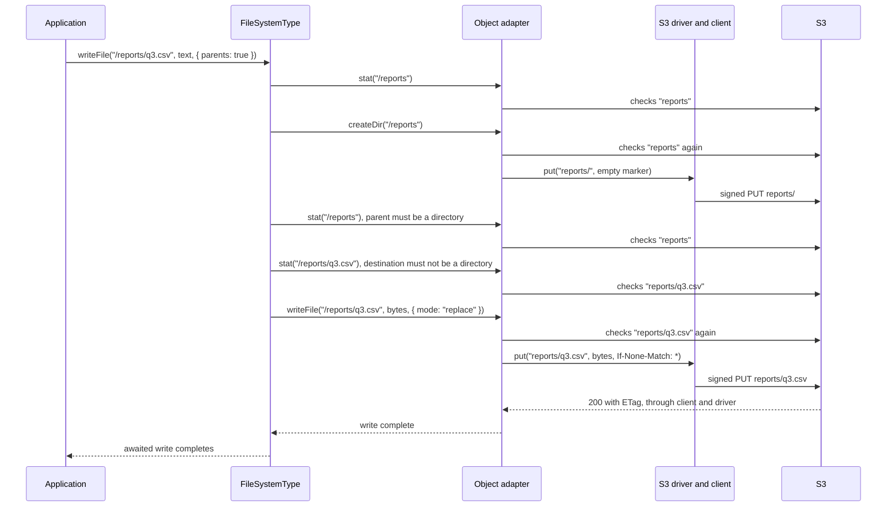
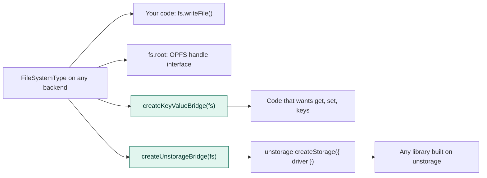
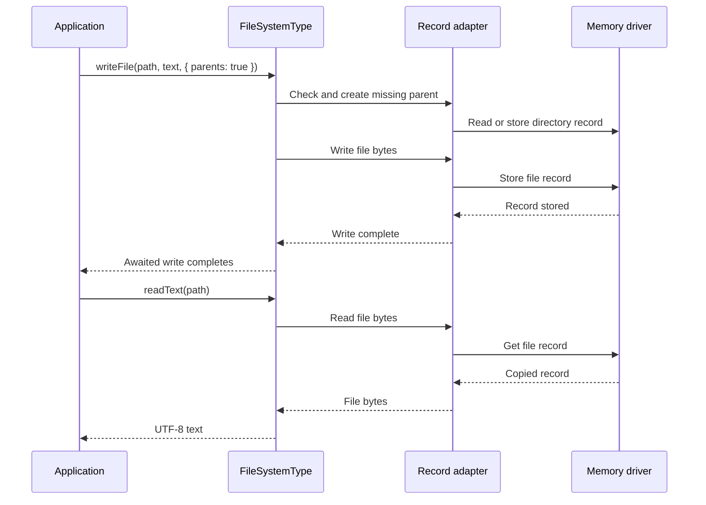

# Choose the storage layer you need

Suppose an application saves a document, opens it later, and lets an existing key-value consumer use the same storage.
The application needs names and file operations. The storage service needs protocol requests or database operations. The
key-value consumer needs its own method names and key rules. These are three different jobs.

OPFS connects those jobs without treating every service as a disk. Start with the filesystem for ordinary file work. Use
a lower layer when you need a provider operation that a file API cannot express. Add a bridge when another library needs
to consume your filesystem.

## Five layers, one question each

Every storage call in this package passes through up to five layers. Each one answers a single question, and each one is
useful on its own:

| Layer            | Question it answers                          | S3 example                                                   | Start here when you need                                      |
| ---------------- | -------------------------------------------- | ------------------------------------------------------------ | ------------------------------------------------------------- |
| Client           | How do I talk to this service?               | `createS3Client()` signs and sends S3 HTTP requests          | an S3-only feature: multipart upload control, receipts, ETags |
| Driver           | What are this backend's rules?               | `createS3Driver()` declares S3's size and part limits        | to check limits or plan work before any request               |
| Adapter          | How does this kind of storage look as files? | `createObjectAdapter()` turns paths into keys                | rarely by hand; `createS3Adapter()` builds it for you         |
| `FileSystemType` | How does my application work with files?     | `createFileSystem()` gives `writeFile`, directories, handles | ordinary file work                                            |
| Bridge, optional | How does another library use these files?    | `createKeyValueBridge()` puts a key-value interface on top   | an existing consumer that expects a different interface       |

Only remote protocols have a client. Node, Deno, Bun, browser OPFS and IndexedDB already have callable APIs, so their
path starts at the driver.

## A driver knows one backend; an adapter knows one shape

The driver and the adapter are the two layers that are easiest to confuse. The difference is what each one is written
for:

- A **driver** is written once per backend. S3, Azure Blob and Google Cloud Storage each have their own driver because
  each has different authentication, size limits, failure rules and optimizations.
- An **adapter** is written once per _shape_ of storage. There are three shapes: **files** (a real filesystem),
  **records** (a value stored under a key, such as a database row) and **objects** (a named blob with metadata, as in
  cloud storage). The adapter turns that shape into files and directories.

So 24 backends share three generic adapters. A backend's own `createXAdapter()` function, such as `createS3Adapter()`,
is a shortcut: it builds that backend's driver and hands it to the adapter for its shape. Adding support for a new
storage service usually means writing one driver and reusing an existing adapter.

Read the diagram from the top. Purple boxes are written once per backend; teal boxes are written once per shape, so
there are only a few of them. Arrows show which layer wraps which; a request travels the opposite way, from the bottom
up to the service.



Three things in the diagram are easy to miss:

- Only remote services have a client. Node, Deno, Bun, browser OPFS and IndexedDB already have callable APIs, so their
  path starts at the driver.
- An adapter does not need a driver. An archive view reads an opened archive and answers the same adapter contract, so
  `createFileSystem(createTarAdapter(archive))` gives a read-only filesystem over a TAR file. The filesystem cannot tell
  the difference.
- The filesystem has three kinds of consumer. Your own code calls its methods directly. Code already written for the
  browser's `FileSystemDirectoryHandle` uses `fs.root` and gets the same handle interface on any backend. Code written
  against another library's interface gets a bridge. The [bridge section](#bridges-give-your-files-to-another-library)
  explains the difference.

The table lists every backend by shape:

| Shape   | Generic adapter               | Backends                                                                                           | What an append or partial update costs                                                                                         |
| ------- | ----------------------------- | -------------------------------------------------------------------------------------------------- | ------------------------------------------------------------------------------------------------------------------------------ |
| Files   | `@okikio/opfs/adapter/file`   | Node, Deno, Bun, browser OPFS, WebDAV, WebHDFS                                                     | Native positional writes on local disks and browser OPFS. WebDAV and WebHDFS have none; `inspect()` reports this               |
| Records | `@okikio/opfs/adapter/record` | memory, IndexedDB, Deno KV, localStorage, Cache Storage, SQLite, D1, db0, Drizzle, RxDB, unstorage | Usually read the whole record, change it, replace it. A driver with a faster route, such as Deno KV, reports it in `inspect()` |
| Objects | `@okikio/opfs/adapter/object` | S3, Azure Blob, Google Cloud Storage, R2, B2, Swift, Cloudflare KV                                 | Read the whole object, change it, replace it; directories are marker objects                                                   |

The last column is why the shape matters. The same `writeFile(path, data, { mode: "append" })` call is cheap on a local
disk and rewrites the whole value on S3 or IndexedDB. The adapter does that rewrite with the shared
[`applyWrite()`](design.md#entry-points-main-types-and-advanced) rule, and the driver's `plan()` tells you about the
limits before you start.

## Why adapters exist

Why not connect each driver straight to `FileSystemType`? Because the filesystem promises things that most backends do
not have, and a driver must not pretend. A driver reports what its backend really does. Something has to build the
missing parts out of what the backend does have, and that work depends on the backend's shape, not on its vendor:

| `FileSystemType` needs        | Files: Node, browser OPFS | Records: IndexedDB, Deno KV, SQLite         | Objects: S3, Azure, GCS                            |
| ----------------------------- | ------------------------- | ------------------------------------------- | -------------------------------------------------- |
| Directories that exist        | Native                    | A directory record                          | A marker object, or any key under the prefix       |
| List one directory level      | Native                    | `list(parent)` on the driver                | LIST with the `/` delimiter                        |
| Append and positional update  | Native positional writes  | Read the record, `applyWrite()`, replace it | Read the object, `applyWrite()`, replace it        |
| Replace without losing a race | Native                    | The driver's declared replacement guarantee | `If-None-Match: *` or `If-Match: <etag>`           |
| A file is never also a folder | Native                    | Checked against the parent's records        | Checked against the file key and the directory key |

Every object store needs the same directory emulation, and every record store needs the same parent bookkeeping. So the
work is written once per shape: the object adapter is about 500 lines and serves 7 backends; the record adapter is about
400 lines and serves 11. A fix to directory emulation in the object adapter fixes S3, Azure, GCS, R2, B2, Swift and
Cloudflare KV at once. The file adapter is about 140 lines because a real filesystem already has these parts; it only
translates capability names.

Why not move that work into `FileSystemType`? Because the filesystem then has to know every shape, and the adapter
contract would stop being a public extension point. Today the filesystem knows one contract, `AdapterType`, with six
required operations. Archive views, the three generic adapters and any adapter you write yourself all meet it. Path
normalization, locks, handles, recursive copy and parent creation stay in one place above it.

Does each shape serve its backends well? Mostly, because a driver can declare **capabilities** that change the adapter's
route without changing the adapter's code:

- `conditionalWrite: false` makes the object adapter write without a precondition. Swift, Cloudflare KV and native B2
  declare this. Concurrent writers then follow last-writer-wins; [design.md](design.md) states that weaker contract.
- `copy: false` turns off provider-side copy. The filesystem then copies by reading and writing, except an exclusive
  copy, which needs an atomic native route and is refused.
- `rangeRead`, `streamRead` and `streamWrite` choose between ranged, streamed and whole-value routes.
- A record driver's `writeModes` lets Deno KV take a native route for append instead of read, change and replace.

The shape model strains when a backend can do something that has no file meaning at all. The next section is about that
case.

## When a backend does more than its shape

Backblaze B2 is a good example. It offers an S3-compatible endpoint and a native API. Through the S3-compatible endpoint
it behaves like S3 with documented gaps: no object-level ACLs, no object tagging, no website configuration and no
browser `POST` uploads to pre-signed URLs ([Backblaze](https://www.backblaze.com/docs/cloud-storage-s3-compatible-api)).
Its native API adds things that S3 does not express the same way: every upload is a version with its own file ID,
removal can hide a name while keeping older versions, and one version can be deleted permanently.

There are two obvious ways to support such extras, and both are costly:

1. **Make the object adapter know every provider's extras.** Each extra then needs a file meaning, and most have none. A
   lifecycle rule, an Object Lock setting or "delete only this version" is not a file operation. The adapter would
   branch on vendor and stop being written once per shape.
2. **Give up on extras.** Then a B2 user loses version IDs, which is exactly why they chose the native API.

The package takes a third route with three channels:

| Channel                        | What travels through it                                         | B2 example                                                             |
| ------------------------------ | --------------------------------------------------------------- | ---------------------------------------------------------------------- |
| Capabilities in the contract   | Facts that change the adapter's route                           | `conditionalWrite: false`, `copy: false`, `versions: true`             |
| Open values in the contract    | Provider values that the adapter passes through without reading | The revision `{ kind: "version", value: fileId }` on every object stat |
| The client, kept by the caller | Everything with no file meaning                                 | `client.getFileInfo(fileId)`, `client.deleteVersion(file)`             |

The client is borrowed, never owned, by the driver and the adapter. You create it, so you keep it, and the filesystem
never takes it away:

```ts
import { authorizeB2, createB2Client } from "@okikio/opfs/b2";
import { createB2Adapter } from "@okikio/opfs/adapter/b2";
import { createFileSystem } from "@okikio/opfs";

const authorization = await authorizeB2({
  applicationKeyId: "caller-provided-key-id",
  applicationKey: "caller-provided-secret",
  fetch: globalThis.fetch,
});
const client = createB2Client({
  authorization,
  bucketId: "caller-provided-bucket-id",
  fetch: globalThis.fetch,
  subtle: globalThis.crypto.subtle,
});
await using fs = createFileSystem(createB2Adapter(client), { coordination: "local" });

// File work goes through the filesystem.
await fs.writeFile("/reports/q3.csv", "quarter,total\nq3,42\n", { parents: true });

// Version work goes through the same client. remove() would only hide the name; this deletes one version for good.
const head = await client.head("reports/q3.csv");
if (head?.revision?.kind === "version") {
  await client.deleteVersion(await client.getFileInfo(head.revision.value));
}
```

Two gaps remain, and both are worth deciding on:

- **Revisions stop at the adapter.** `FileStatType` has no revision field, so a caller of `fs.stat()` cannot see an S3
  ETag, a GCS generation or a B2 file ID, even though most object stores report one. Revisions have a clear file
  meaning, "this exact content", so they are a good candidate to promote into the shared contract as an optional field.
- **No typed path from a filesystem to its driver.** You must keep the client yourself. `fs.inspect()` reports the
  driver's name, capabilities and limits, not its methods.

The rule that follows: promote a provider feature into the shared contract when several backends have it and it has a
file meaning. Keep everything else on the client.

## Follow one S3 write through every layer

This example builds each layer by hand so you can see where each one starts and ends. The endpoint and credentials are
placeholders; the [S3 guide](s3.md) explains real configuration.

```ts
import { createFileSystem } from "@okikio/opfs";
import { createObjectAdapter } from "@okikio/opfs/adapter/object";
import { createS3DriverFromClient } from "@okikio/opfs/driver/s3";
import { createS3Client } from "@okikio/opfs/s3";

// 1. Client: knows how to sign and send S3 requests. Nothing about files.
const client = createS3Client({
  endpoint: "https://s3.us-east-1.amazonaws.com",
  bucket: "example-bucket",
  region: "us-east-1",
  credentials: { accessKeyId: "APPLICATION_ACCESS_KEY", secretAccessKey: "APPLICATION_SECRET" },
});

// 2. Driver: knows S3's rules. plan() checks a write against them without sending a request.
const driver = createS3DriverFromClient(client);
console.log(driver.plan({ operation: "write", path: "/reports/q3.csv", size: 6 * 1024 ** 3 }));

// 3. Adapter: makes objects look like files. Paths become keys; directories become marker objects.
const adapter = createObjectAdapter(driver);

// 4. Filesystem: the API your application uses.
await using files = createFileSystem(adapter, { disposeAdapter: true });
await files.writeFile("/reports/q3.csv", "region,total\nwest,42\n", { parents: true });
```

In application code, steps 2 and 3 are usually one call: `createFileSystem(createS3Adapter(client))`. Build them
separately when you want the driver's `plan()` and `inspect()`, or when you write your own driver.

That single `writeFile()` call does different work at each layer:

| Layer          | Receives                                                | Does                                                                                                                                                                                                 | Calls next                                                            |
| -------------- | ------------------------------------------------------- | ---------------------------------------------------------------------------------------------------------------------------------------------------------------------------------------------------- | --------------------------------------------------------------------- |
| Filesystem     | `writeFile("/reports/q3.csv", text, { parents: true })` | Checks the write against the backend's limits, locks the file path, creates the missing `/reports` directory, checks the parent and destination, encodes the text                                    | `adapter.createDir("/reports")`, then `adapter.writeFile(...)`        |
| Object adapter | Paths                                                   | Maps `/reports` to the marker key `reports/` and the file to the key `reports/q3.csv`. Checks the path is not a directory. Adds an ETag condition so a concurrent change is not silently overwritten | `driver.head(...)`, `driver.put("reports/q3.csv", bytes, conditions)` |
| S3 driver      | Keys and bytes                                          | Holds S3's limits and requirements for planning, and forwards object calls                                                                                                                           | `client.put(...)`                                                     |
| S3 client      | Keys and bytes                                          | Signs the request, sends one `PUT` or a multipart upload, returns a receipt with the ETag                                                                                                            | HTTPS to S3                                                           |

The ETag condition comes from the adapter, not from S3 itself. For a new file it sends `If-None-Match: *`, which fails
if someone created the object in the meantime. For an existing file it sends `If-Match` with the ETag it just read.

The sequence below shows the same call over time. Each "checks" note stands for three requests the adapter sends through
the driver and client: a `HEAD` for a file with that name, a `HEAD` for a directory marker, and a `LIST` for any key
under the prefix.



These are the actual requests the call above sends, recorded by running it against a stand-in S3 endpoint that logs each
request:

```text
HEAD reports            ┐
HEAD reports/           ├ filesystem: does /reports exist? (no)
LIST prefix=reports/    ┘
HEAD reports            ┐
HEAD reports/           ├ adapter, inside createDir: check again before writing
LIST prefix=reports/    ┘
PUT  reports/ (0 bytes)   adapter: the directory marker
HEAD reports            ┐
HEAD reports/           ├ filesystem: is the parent now a directory? (yes)
LIST prefix=reports/    ┘
HEAD reports/q3.csv     ┐
HEAD reports/q3.csv/    ├ filesystem: is the destination a directory? (no)
LIST prefix=reports/q3.csv/
HEAD reports/q3.csv     ┐
HEAD reports/q3.csv/    ├ adapter, inside writeFile: check again right before writing
LIST prefix=reports/q3.csv/
PUT  reports/q3.csv (21 bytes) If-None-Match: *
```

To decide whether `/reports` exists, the adapter asks three questions in order: is there an object named `reports` (a
file)? Is there a marker object `reports/` (an empty directory)? Does any key start with `reports/` (a directory that
only exists because files are under it)? Object storage has no real directories, so this is how the adapter makes them.

Seventeen requests for one small file is the cost of making object storage behave like a filesystem safely. Two checks
repeat on purpose. The adapter checks again inside `createDir()` and `writeFile()` because another writer can change the
bucket between the filesystem's check and the write. The filesystem checks the destination itself unless you set
`optimizations.writeAdmission: true`, which lets an adapter that validates replacements do that check alone for a
complete replacement; [architecture and invariants](design.md) explains the conditions. A file adapter on a local disk
answers the same questions with one `stat` each.

Creating `/reports` and writing the file are separate requests. If the second one fails, the marker from the first one
stays. The filesystem does not pretend the two steps are one transaction.

## What each layer does not do

Knowing where a layer stops is as useful as knowing what it does:

- A **client** knows nothing about paths or directories. `client.put("reports/q3.csv", ...)` is an object key, not a
  file.
- A **driver** does not walk directories recursively or emulate an operation its backend lacks. It reports what the
  backend can do and what it cannot.
- An **adapter** holds no credentials and no provider limits. It asks its driver, and it supports only six required
  operations: `stat`, `readFile`, `writeFile`, `readDir`, `createDir` and `remove`.
- The **filesystem** does not know which backend it is on. Recursive copy, move and walk, parent creation and locks live
  here, built from the adapter's six operations when the adapter has no faster route.
- A **bridge** adds no storage. It gives an existing filesystem another library's interface, with that library's naming
  rules.

## Where to start

| You want to                                                      | Start at                                                                                    |
| ---------------------------------------------------------------- | ------------------------------------------------------------------------------------------- |
| Read and write files in an application                           | `createFileSystem(createS3Adapter(client))`, or any `@okikio/opfs/adapter/<backend>`        |
| Check limits or plan a large upload before doing it              | The driver: `driver.inspect()` and `driver.plan(...)`                                       |
| Use a feature only the service has, such as multipart control    | The client                                                                                  |
| Support a new storage service                                    | Write a driver for its shape and reuse the shape's adapter; see [extensions](extensions.md) |
| Give your files to a library that expects key-value or unstorage | A bridge: `@okikio/opfs/bridge/kv` or `@okikio/opfs/bridge/unstorage`                       |
| Read one archive or byte range without any filesystem            | A [byte source](source.md); see the last sections of this page                              |

## Save a document, then expose a key-value view

This complete example uses memory, so it needs no account, credentials or host directory. Run it with the package
installed in a runtime that supports explicit resource management. Memory is useful for trying the API; its contents do
not survive the process.

```ts
import { createFileSystem } from "@okikio/opfs";
import { createMemoryAdapter } from "@okikio/opfs/adapter/memory";
import { createKeyValueBridge } from "@okikio/opfs/bridge/kv";

await using files = createFileSystem(createMemoryAdapter(), {
  coordination: "local",
  disposeAdapter: true,
});

await files.writeFile("/documents/draft.txt", "First draft", { parents: true });
console.log(await files.readText("/documents/draft.txt")); // First draft

const values = createKeyValueBridge(files);
try {
  await values.set("editor:theme", "dark");
  console.log(await values.get("editor:theme")); // dark
  console.log(await files.readText("/documents/draft.txt")); // First draft
} finally {
  await values.dispose();
}
```

`files` is a `FileSystemType`: the application-facing file API. The memory adapter supplies its storage operations.
`values` is a bridge over that same filesystem. It encodes keys into its dedicated `/.opfs-kv` directory, so a key and
its descendants can coexist without becoming conflicting file and directory names. It does not turn every existing file
into a key. The document remains an ordinary file outside that reserved area.

The bridge borrows `files` by default. Disposing the bridge leaves the filesystem open. Here `await using` closes the
filesystem at the end of the scope, and `disposeAdapter: true` also disposes its adapter. Finish reads, streams and file
resources before leaving that scope; filesystem close does not settle resources already returned to callers.

## Bridges: give your files to another library

A filesystem has three kinds of consumer, and only one of them needs a bridge:

| Consumer                                            | What it calls                                                           | Needs                                |
| --------------------------------------------------- | ----------------------------------------------------------------------- | ------------------------------------ |
| Your own code                                       | `fs.writeFile()`, `fs.readText()`, `fs.walk()`                          | Nothing; this is `FileSystemType`    |
| Code written for browser OPFS handles               | `getFileHandle()`, `createWritable()`, `createSyncAccessHandle()`       | Nothing; `fs.root` is that interface |
| A library written against another storage interface | That library's methods, such as unstorage's `getItem()` and `setItem()` | A bridge                             |

The handle interface is built into `FileSystemType` because this package is shaped like OPFS: code written against the
handle returned by `navigator.storage.getDirectory()` can use `fs.root` with the same method names, whatever the
backend. It is a structural match, not the browser's own objects, so a check such as
`instanceof FileSystemDirectoryHandle` fails. A bridge is for the other case. It starts from a `FileSystemType` and
implements a different library's contract on top of it, so that library stores its data in your filesystem without
knowing it.



For example, any code that uses unstorage can keep its data in a filesystem backed by S3, IndexedDB or a local
directory. Install `unstorage` yourself; this package does not depend on it. The example was run with unstorage 1.x and
2.0.0-beta.0:

```ts
import { createStorage } from "unstorage";
import { createFileSystem } from "@okikio/opfs";
import { createMemoryAdapter } from "@okikio/opfs/adapter/memory";
import { createUnstorageBridge } from "@okikio/opfs/bridge/unstorage";

await using files = createFileSystem(createMemoryAdapter(), { coordination: "local" });
const storage = createStorage({ driver: createUnstorageBridge(files) });

await storage.setItem("cache:user:1", { name: "Ada" });
console.log(await storage.getItem("cache:user:1")); // { name: "Ada" }
console.log(await storage.getKeys("cache")); // [ "cache:user:1" ]
await storage.dispose();
```

### How a bridge maps keys to files

A key-value store and a filesystem disagree in one important way. A store can hold both `cache` and `cache:user`, but a
filesystem cannot make `/cache` a file and a directory at the same time. So a bridge does not turn `cache:user` into
`/cache/user`. It gives every key its own directory and stores the value in a `value` file inside it:

```text
key "cache"        ->  /.opfs-kv/key-cache/value
key "cache:user"   ->  /.opfs-kv/key-cache/key-user/value
```

Each colon-separated segment is encoded into one safe file name, with a `key-` prefix that keeps bridge entries apart
from other names. Everything lives under one reserved directory, `/.opfs-kv` by default, which holds a `.format` marker
naming the layout. `clear()` removes only value files the bridge owns, so ordinary files elsewhere in the filesystem are
never touched.

The bridge borrows the filesystem: disposing the bridge leaves the filesystem open, unless you pass
`disposeFileSystem: true`. Its `inspect()` and `plan()` return the filesystem's own capabilities and limits, so a caller
sees the real backend rules, not a second set invented by the bridge.

### The bridges that exist, and the ones that do not

| Bridge                          | Interface it implements                  | Use it for                                                      |
| ------------------------------- | ---------------------------------------- | --------------------------------------------------------------- |
| `@okikio/opfs/bridge/kv`        | A small `get`/`set`/`keys`/`clear` store | Your own code, or a library with a minimal async key-value need |
| `@okikio/opfs/bridge/unstorage` | An unstorage `Driver`                    | `createStorage({ driver })` and everything built on unstorage   |

A bridge is only honest when the filesystem can satisfy the whole contract. Some popular interfaces need more than files
can give, so they have no bridge:

- **RxDB** stores data through `RxStorage`, which needs bulk writes with per-document conflicts, queries, change streams
  and checkpoints. A wrapper that renames file methods would break those promises. A real `bridge/rxdb` would be a full
  storage engine.
- **SQL and Drizzle** need a query engine. The right route is a SQLite VFS that stores the database file in a
  filesystem; that is future work.

The reverse direction is different and often easier. RxDB, db0, Drizzle and unstorage can all be the _storage below_ a
filesystem today, as record drivers. [Ecosystem integrations](ecosystems.md) lists both directions for each library, and
`@okikio/opfs/integration/catalog` records which directions each one supports.

## See what the convenience constructor hides

`createMemoryAdapter()` constructs a memory record driver and passes it through the generic record adapter. If you need
to inspect or use that driver separately, compose the same public parts yourself:

```ts
import { createFileSystem } from "@okikio/opfs";
import { createRecordAdapter } from "@okikio/opfs/adapter/record";
import { createMemoryDriver } from "@okikio/opfs/driver/memory";

const driver = createMemoryDriver();
const adapter = createRecordAdapter(driver, { name: "memory", disposeDriver: true });
await using files = createFileSystem(adapter, { disposeAdapter: true });

await files.writeFile("/draft.txt", "First draft");
console.log(await files.readText("/draft.txt")); // First draft
console.log(driver.size); // 1 stored record; the root is implicit
```

The driver stores logical file and directory records. The adapter translates those records into filesystem primitives.
The filesystem adds path and handle behavior. This example transfers disposal down the same chain: filesystem → adapter
→ driver. Without each explicit transfer, the corresponding injected resource stays borrowed.

## Follow one write and one read

For the first example, `parents: true` asks the filesystem to create missing parent directories before the file write.
The filesystem coordinates the mutation, the adapter constructs record operations, and the memory driver stores copies
of those records. Only after the awaited write succeeds does the example print the saved text.

The sequence below shows those owners for this memory example. A remote object backend can have additional requests,
conditional writes or multipart publication. The diagram does not promise that the entire directory-and-file operation
is one transaction.



If a write fails, do not assume it undid earlier parent creation or remote effects. Read the selected driver's
publication contract before retrying an ambiguous remote mutation. Filesystem errors have stable codes; code should use
those codes rather than matching explanatory messages. [Storage ownership](storage.md) explains the publication and
cleanup contracts in detail.

## Choose a backend family without changing its promises

`FileSystemType` is the facade's TypeScript contract, not a storage format. Under it, three driver families preserve
different backend strengths:

| Family        | Native unit                                | Consequence for file operations                                                                                                        |
| ------------- | ------------------------------------------ | -------------------------------------------------------------------------------------------------------------------------------------- |
| File driver   | File, directory and often positional bytes | A host filesystem can often read ranges or write positions directly. Mount and runtime profiles still control what is safe.            |
| Record driver | Complete logical record or value           | A generic byte update may read and replace a complete value. A stronger driver can expose native byte or transaction routes.           |
| Object driver | Named object plus metadata and revisions   | A directory is a projection of keys. Copy, replacement, conditional publication and multipart uploads retain provider-specific limits. |

For ordinary use, choose a convenience adapter such as `adapter/node`, `adapter/gcs` or `adapter/memory`. For a new
service, implement the appropriate public driver family and reuse its generic adapter. This avoids reimplementing
filesystem translation in every provider package. [Extension authoring](extensions.md) gives the supported seams.

Having a method does not establish its physical cost. A backend without native range reads can return a requested range
after reading the complete value. A portable move can use copy followed by removal and lack native rename atomicity.
Call `inspect()` for the effective route and limits, and `plan()` for known constraints before expensive work. Both are
preflight tools, not network probes or guarantees about future service availability.

## Resize files separately from transfer progress

A write cursor says where the next write starts; a file length says which bytes belong to the file. Seeking changes the
cursor. Truncating sets the length: shrinking discards the tail, while growing adds zero bytes. Neither operation
records which bytes a remote upload acknowledged. A resumable transfer needs its own source identity, session and
checkpoint.

The [complete resize example](api.md#resize-a-file-without-confusing-size-with-the-write-cursor) shows truncation,
seeking past the end and zero-filled gaps. It also distinguishes a staged writable, which publishes on close and retains
its image in memory, from a direct positional resource, whose writes can already be visible before close. Select the
route from the backend capabilities and publication contract; aborting a direct resource is not a rollback promise.

## Stop at bytes when files add no value

A preview of one remote archive does not always need paths, directories or a writable filesystem. A byte source provides
a known size, identity and exact range reads. An archive reader interprets its headers and members. A read-only view can
then project the admitted archive namespace into `FileSystemType` if a consumer actually needs file handles.

Use [sources](source.md) to learn the byte contract, [archives](archive.md) for bounded member previews, and
[transfer recovery](transfer.md) for acknowledged upload checkpoints. A `ReadableStream` supplies incremental bytes and
backpressure; it does not by itself supply random access, replay after a crash or durable upload progress. Those
properties require explicit source and protocol support.

## Find the owner when changing behavior

The implementation follows the same boundaries. Each backend keeps its layers together in `src/backend/<name>/`:
`client.ts` when it has a wire protocol, `driver.ts`, and `adapter.ts` for its convenience constructor. The three
generic adapters live in `src/adapter/` (`file.ts`, `record.ts`, `object.ts`), the shared driver contracts in
`src/driver/`, the facade in `src/filesystem.ts`, and outgoing contracts under `src/bridge/`. `src/integration/`
describes available directions; it does not execute them.

[Architecture and invariants](design.md) records the rules maintainers must preserve.
[Drivers and adapters](adapters.md) lists concrete implementations, and [ecosystems](ecosystems.md) describes their
direction-specific contracts. The memory and bridge behavior above is covered by the existing filesystem, architecture
and ecosystem suites. Those local contracts do not establish acceptance by a live cloud service or the semantics of an
untested extension.
