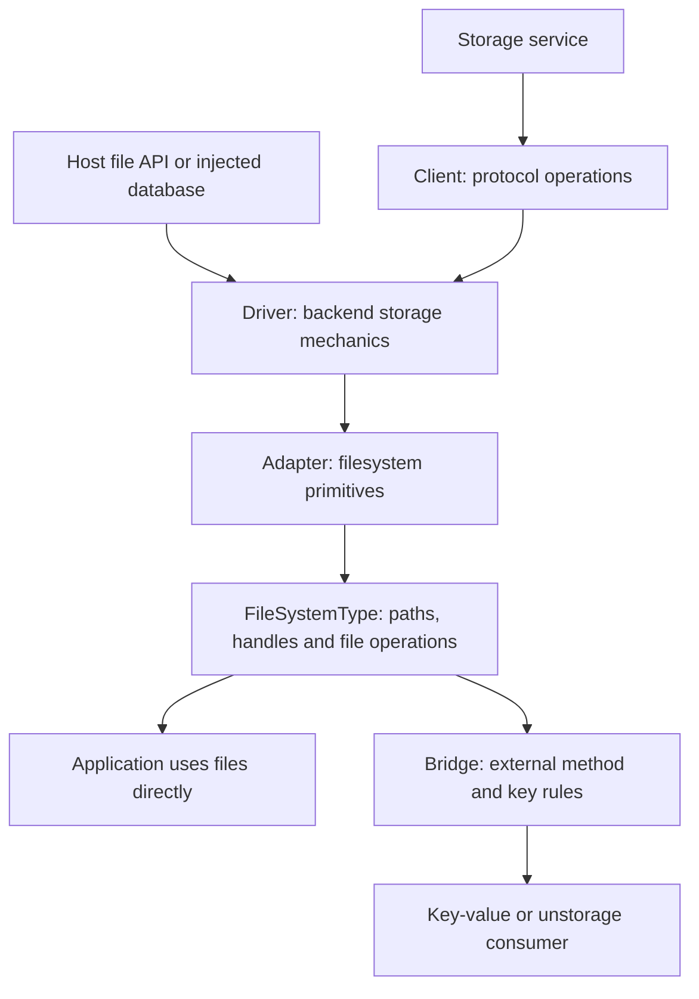
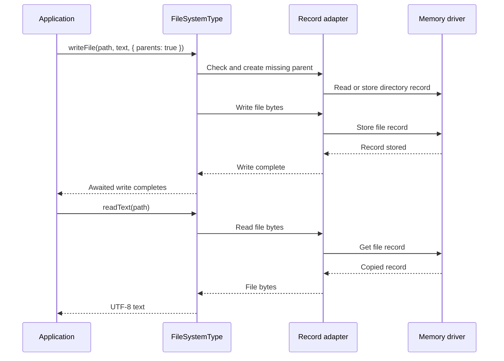

# Choose the storage layer you need

Suppose an application saves a document, opens it later, and lets an existing key-value consumer use the same storage.
The application needs names and file operations. The storage service needs protocol requests or database operations. The
key-value consumer needs its own method names and key rules. These are three different jobs.

OPFS connects those jobs without treating every service as a disk. Start with the filesystem for ordinary file work. Use
a lower layer when you need a provider operation that a file API cannot express. Add a bridge when another library needs
to consume your filesystem.

## Save a document, then expose a key-value view

This complete example uses memory, so it needs no account, credentials or host directory. Run it with the package
installed in a runtime that supports explicit resource management. Memory is useful for trying the API; its contents do
not survive the process.

```ts
import { createFileSystem } from "@okikio/opfs";
import { createMemoryAdapter } from "@okikio/opfs/adapter/memory";
import { createKeyValueBridge } from "@okikio/opfs/bridge/kv";

await using files = createFileSystem(createMemoryAdapter(), {
  coordination: "local",
  disposeAdapter: true,
});

await files.writeFile("/documents/draft.txt", "First draft", { parents: true });
console.log(await files.readText("/documents/draft.txt")); // First draft

const values = createKeyValueBridge(files);
try {
  await values.set("editor:theme", "dark");
  console.log(await values.get("editor:theme")); // dark
  console.log(await files.readText("/documents/draft.txt")); // First draft
} finally {
  await values.dispose();
}
```

`files` is a `FileSystemType`: the application-facing file API. The memory adapter supplies its storage operations.
`values` is a bridge over that same filesystem. It encodes keys into its dedicated `/.opfs-kv` directory, so a key and
its descendants can coexist without becoming conflicting file and directory names. It does not turn every existing file
into a key. The document remains an ordinary file outside that reserved area.

The bridge borrows `files` by default. Disposing the bridge leaves the filesystem open. Here `await using` closes the
filesystem at the end of the scope, and `disposeAdapter: true` also disposes its adapter. Finish reads, streams and file
resources before leaving that scope; filesystem close does not settle resources already returned to callers.

## Understand the two directions

The defining composition path is **client → driver → adapter → FileSystemType → bridge**. The first four stages bring
storage into the file API. The last stage lets another interface use that file API. A client is optional when the
backend already exposes callable file or database methods.

This diagram shows dependency and translation direction, rather than the order of individual network requests. Read it
from storage toward its consumers. Applications can stop at a client or driver; they need not construct all five layers.
Retry and publication details remain specific to the selected backend.



| Layer            | Question it answers                                       | Concrete reason to use it                                                                                               |
| ---------------- | --------------------------------------------------------- | ----------------------------------------------------------------------------------------------------------------------- |
| Client           | What does this protocol let me request?                   | Keep S3 upload IDs, conditional requests or native metadata without projecting a filesystem.                            |
| Driver           | How does this configured backend store data?              | Inspect backend limits, physical operations and storage policy independently of file traversal.                         |
| Adapter          | How can this driver supply filesystem primitives?         | Translate native files, logical records or objects into `stat`, reads, writes, listing, directory creation and removal. |
| `FileSystemType` | How does my application work with paths and file handles? | Create parents, walk directories, coordinate mutations and use portable fallbacks.                                      |
| Bridge           | How can another ecosystem consume these files?            | Supply a real key-value or unstorage contract, including its naming and disposal rules.                                 |

An adapter and a bridge therefore face different directions. An unstorage **adapter** takes an existing unstorage
`Storage` and makes it usable by `FileSystemType`. An unstorage **bridge** takes an existing `FileSystemType` and
returns an unstorage Driver-shaped interface. Neither direction implies the other. A database adapter cannot provide a
reverse SQL bridge just by renaming file methods: queries, transactions and conflict rules require actual
implementations.

## See what the convenience constructor hides

`createMemoryAdapter()` constructs a memory record driver and passes it through the generic record adapter. If you need
to inspect or use that driver separately, compose the same public parts yourself:

```ts
import { createFileSystem } from "@okikio/opfs";
import { createRecordAdapter } from "@okikio/opfs/adapter/record";
import { createMemoryDriver } from "@okikio/opfs/driver/memory";

const driver = createMemoryDriver();
const adapter = createRecordAdapter(driver, { name: "memory", disposeDriver: true });
await using files = createFileSystem(adapter, { disposeAdapter: true });

await files.writeFile("/draft.txt", "First draft");
console.log(await files.readText("/draft.txt")); // First draft
console.log(driver.size); // 1 stored record; the root is implicit
```

The driver stores logical file and directory records. The adapter translates those records into filesystem primitives.
The filesystem adds path and handle behavior. This example transfers disposal down the same chain: filesystem → adapter
→ driver. Without each explicit transfer, the corresponding injected resource stays borrowed.

## Follow one write and one read

For the first example, `parents: true` asks the filesystem to create missing parent directories before the file write.
The filesystem coordinates the mutation, the adapter constructs record operations, and the memory driver stores copies
of those records. Only after the awaited write succeeds does the example print the saved text.

The sequence below shows those owners for this memory example. A remote object backend can have additional requests,
conditional writes or multipart publication. The diagram does not promise that the entire directory-and-file operation
is one transaction.



If a write fails, do not assume it undid earlier parent creation or remote effects. Read the selected driver's
publication contract before retrying an ambiguous remote mutation. Filesystem errors have stable codes; code should use
those codes rather than matching explanatory messages. [Storage ownership](storage.md) explains the publication and
cleanup contracts in detail.

## Choose a backend family without changing its promises

`FileSystemType` is the facade's TypeScript contract, not a storage format. Under it, three driver families preserve
different backend strengths:

| Family        | Native unit                                | Consequence for file operations                                                                                                        |
| ------------- | ------------------------------------------ | -------------------------------------------------------------------------------------------------------------------------------------- |
| File driver   | File, directory and often positional bytes | A host filesystem can often read ranges or write positions directly. Mount and runtime profiles still control what is safe.            |
| Record driver | Complete logical record or value           | A generic byte update may read and replace a complete value. A stronger driver can expose native byte or transaction routes.           |
| Object driver | Named object plus metadata and revisions   | A directory is a projection of keys. Copy, replacement, conditional publication and multipart uploads retain provider-specific limits. |

For ordinary use, choose a convenience adapter such as `adapter/node`, `adapter/gcs` or `adapter/memory`. For a new
service, implement the appropriate public driver family and reuse its generic adapter. This avoids reimplementing
filesystem translation in every provider package. [Extension authoring](extensions.md) gives the supported seams.

Having a method does not establish its physical cost. A backend without native range reads can return a requested range
after reading the complete value. A portable move can use copy followed by removal and lack native rename atomicity.
Call `inspect()` for the effective route and limits, and `plan()` for known constraints before expensive work. Both are
preflight tools, not network probes or guarantees about future service availability.

## Stop at bytes when files add no value

A preview of one remote archive does not always need paths, directories or a writable filesystem. A byte source provides
a known size, identity and exact range reads. An archive reader interprets its headers and members. A read-only view can
then project the admitted archive namespace into `FileSystemType` if a consumer actually needs file handles.

Use [sources](source.md) to learn the byte contract, [archives](archive.md) for bounded member previews, and
[transfer recovery](transfer.md) for acknowledged upload checkpoints. A `ReadableStream` supplies incremental bytes and
backpressure; it does not by itself supply random access, replay after a crash or durable upload progress. Those
properties require explicit source and protocol support.

## Find the owner when changing behavior

The implementation follows the same boundaries: protocol modules such as `src/s3.ts`, backend implementations under
`src/driver/`, translation under `src/adapter/`, the facade in `src/filesystem.ts`, and outgoing contracts under
`src/bridge/`. `src/integration/` describes available directions; it does not execute them.

[Architecture and invariants](design.md) records the rules maintainers must preserve.
[Drivers and adapters](adapters.md) lists concrete implementations, and [ecosystems](ecosystems.md) describes their
direction-specific contracts. The memory and bridge behavior above is covered by the existing filesystem, architecture
and ecosystem suites. Those local contracts do not establish acceptance by a live cloud service or the semantics of an
untested extension.
