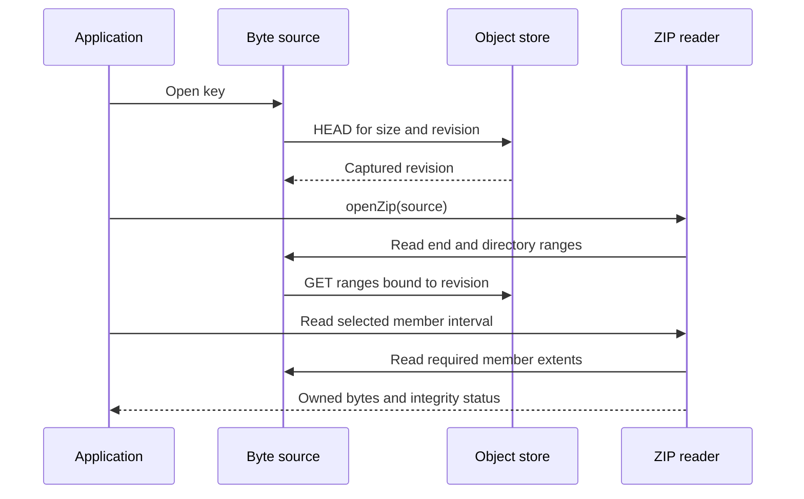

# Read a stable byte object

Use a byte source when the operation needs one object rather than a directory or a writable filesystem. Archives and
resumable uploads can use the same public source contract. A plain stream remains a one-shot input; it does not become
seekable or replayable by wrapping it in an interface.

Think of a stream as bytes arriving through a pipe, and an addressable source as a fixed document whose pages can be
requested again. The pipe suits a sequential download or decoder. The document suits a ZIP reader that first needs the
end of a file, then its directory, then one member near the beginning. Both can limit memory use, but they make
different promises about where the next bytes come from.

| Input                               | What the consumer can ask for                    | What survives a restart                                                                           |
| ----------------------------------- | ------------------------------------------------ | ------------------------------------------------------------------------------------------------- |
| `ReadableStream<Uint8Array>`        | The next chunk, until EOF or cancellation        | Nothing by itself; consumed chunks are gone                                                       |
| `ByteSourceType`                    | An exact `(offset, length)` within a known size  | Only what its stable identity and reopening implementation guarantee                              |
| `Blob` through `createBlobSource()` | Ranges from one immutable Blob                   | The application must retain or reopen the same Blob contents                                      |
| Object through `openObjectSource()` | Provider-bound ranges from the captured revision | The provider must still retain that revision and the application must retain authority to read it |

## Read a range before composing more layers

This example owns a snapshot of four bytes. Reading two bytes does not move a cursor, so a second read can request the
same interval. Out-of-bounds requests reject rather than silently returning fewer bytes.

```ts
import { createByteSource } from "@okikio/opfs/source";

const source = createByteSource(new Uint8Array([10, 20, 30, 40]));
console.log([...await source.read(1, 2)]); // [20, 30]
console.log([...await source.read(1, 2)]); // [20, 30]
```

`read()` returns an array, so each individual range is materialized. An addressable source avoids materializing the
_whole object_ when its underlying implementation can fetch only that range. It does not make an unlimited individual
read safe. Use finite range sizes and a shared budget before adding archive or encryption readers.

## Follow a remote preview

The next example reads one ZIP member from GCS. The request ledger surrounds the remote source, so directory reads and
member reads consume the same allowance. The archive reader adds separate decoded-byte limits because a small compressed
extent can expand into much more data.

```ts
import { createGcsClient } from "@okikio/opfs/gcs";
import { budgetSource, createSourceBudget, openObjectSource } from "@okikio/opfs/source";
import { openZip } from "@okikio/opfs/archive/zip";

// The application supplies and refreshes this token. No environment is consulted.
export async function preview(bucket: string, key: string, token: () => Promise<string>) {
  const client = createGcsClient({ bucket, token });
  const ledger = createSourceBudget({ maxBytes: 32 * 1024 * 1024, maxRequests: 100 });
  const source = budgetSource(await openObjectSource(client, key), ledger);
  const archive = await openZip(source);
  const member = archive.entries.find((entry) => entry.kind === "file" && !entry.encrypted);
  if (!member) return null;
  const result = await archive.read(member.id, {
    length: Math.min(4096, member.size),
    maxSourceBytes: 8 * 1024 * 1024,
    maxDecodedBytes: 16 * 1024 * 1024,
  });
  return { name: member.name, ...result, sourceWork: ledger.inspect() };
}
```

This function returns bytes and their checksum status. The application chooses a renderer and treats active content as
untrusted. A prefix does not establish a complete member's CRC. Unsupported compression/encryption and exhausted budgets
reject explicitly rather than extracting the whole archive or downloading a codec.

The sequence below shows why a stable revision matters. All ranges belong to the revision captured by HEAD; mixing
directory offsets from one revision with payload bytes from another would make the preview invalid. The diagram omits
authentication and retry policy; those belong to the configured client and caller.



For a Web Stream, a reader locks the stream until it releases that lock. A read asks for the next chunk; it does not
specify a file offset. `pipeTo()` coordinates reading and writing with backpressure, so a cooperative upstream producer
does not run arbitrarily far ahead of a slow sink. This is a flow-control rule, not a universal memory limit: producers,
transports and codecs can buffer internally. Cancel a stream you stop consuming and release an explicitly acquired
reader in `finally`. Releasing a lock alone does not cancel the producer. See [transfer recovery](transfer.md) for the
additional identities, acknowledgments and saved state needed to resume after process loss.

## Keep source guarantees visible

`ByteSourceType` has a safe-integer `size` and an exact `read(offset, length, { signal })` operation. Short reads
reject. Empty reads need no provider request. `StreamSourceType` describes a one-shot Web Stream and optional length
separately. Do not invent size, range or reopen capabilities for an unknown-length stream.

`createByteSource()` snapshots bytes; later input mutations cannot change the source. `createBlobSource()` borrows an
immutable Blob. Each read returns an owned array. A caller-supplied identity can support restart comparison, but it is
not a content hash computed by the library and must change when the input changes.

`openObjectSource()` borrows only `head`, `get`, `capabilities.rangeRead` and optional `identity`; both object clients
and object drivers fit this read-only contract without sharing their different limit metadata. It performs one HEAD and
binds later ranges to a native generation, immutable version ID or strong ETag. A changed current object either leaves a
provider-addressable old revision readable or rejects; it must not silently change the bytes under an existing index.
GCS generations remain decimal strings, separate from ETags; B2 file IDs use the opaque `version` kind. S3/Azure reject
other providers’ generation and version conditions before network work. A backend with no revision requires explicit
`assumeStable: true`; its `stability` is `caller`, not `provider`. Weak ETags cannot establish provider-bound stability.

Automatic replay identity includes the configured service and bucket/container namespace, object key, revision and size.
A third-party backend can supply its stable `identity`, or the caller can supply an explicit `namespace` when opening
it. Without either, the source omits `identity`: range inspection can still work, but a resumable transfer cannot safely
identify it. Matching ETags in two different buckets must never make them the same replay source.

The default maximum per-read allocation is 8 MiB. Increase `maxReadBytes` explicitly for a larger individual directory
or member request. `budgetSource()` shares physical extent/request admission across readers, including nested readers
that reuse it. Failed requests consume their reserved budget. This ledger does not measure hidden transport work in a
third-party implementation. Archive readers additionally accept a shared archive ledger for aggregate decoded/output
work across nested reads; codec-internal allocation remains the codec's responsibility. A 4 KiB output request may
require much more fetched, decoded or authenticated data.

Sources and clients are borrowed. Reading owns its response reader and retires it after completion, failure or abort; it
never disposes an injected client. The snapshot itself starts no background work. For independently authored sources,
use the [extension guide](extensions.md) and optional source conformance suite. See [archives](archive.md) for exact
container profiles and [transfer recovery](transfer.md) for checkpoint identity and exclusive session ownership.
