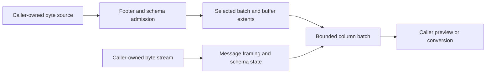

# Arrow IPC: bounded column previews

Status: implemented six-type indexed and forward-stream profile, updated 2026-11-06. Source checks, native-original
comparisons and extracted Node/Deno/Bun consumers passed. Exact pushed-head CI remains a separate delivery gate; no
release has been published. The catalog's `format-arrow` record describes a broader inventory than this profile. The
separate [IPC native harness](../../tests/fixtures/ipc/README.md) passed ten Arrow C++ writer/reader profiles against
authored originals. The shared [Parquet/ORC harness](../../tests/fixtures/arrow/native.cpp) remains unchanged.

This plan is for a library maintainer implementing a preview of typed columns without loading an entire dataset. A
caller should be able to inspect a schema, select one record batch and a few columns, and obtain their values and null
masks under explicit read and memory budgets. A record batch is a group of equally sized columns. It is the unit of
incremental delivery; streaming does not mean one scalar at a time or constant memory independent of batch size.

For example, a UI displaying 20 rows from the final batch of a large object should read its footer, selected batch
metadata and selected column extents. It should report the bytes actually read. A forward-only stream needs to pass
earlier messages before reaching that batch. Neither path should promise that showing 20 rows always reads only 20
values: validation, dictionaries and compressed buffers can require larger units.

## First implementation contract

The draft uses a focused `src/dataset/arrow.ts` entry and internal files with separate metadata, framing and column
invariants. A proposed `./dataset/arrow` subpath must be added to both manifests only with implementation and public
consumer proof. Keep root imports inert. This is a dataset reader, not a writable filesystem driver or a bridge. A later
read-only filesystem projection must name its path and serialization rules separately.

Start with these explicit admissions. This is a deliberately narrow profile, not a claim of complete Arrow or Feather
support.

| Area            | First profile                                                                                       | Deferred or rejected explicitly                                                                                                                           |
| --------------- | --------------------------------------------------------------------------------------------------- | --------------------------------------------------------------------------------------------------------------------------------------------------------- |
| Envelope        | IPC file and IPC stream, V5 metadata, modern continuation framing                                   | V1–V4 metadata, legacy four-byte message prefixes, Feather V1, concatenated streams, Flight, tensor messages                                              |
| Physical values | Signed Int32/Int64, Float64, bit-packed Bool, Binary and Utf8 with 32-bit offsets                   | Other integer widths and unsigned types, Float32/16, Null, FixedSizeBinary, large-offset/view types, decimals, temporal/interval types and nested layouts |
| Nulls           | Separate validity bitmap, validate lengths and null counts; preserve null versus empty bytes/string | Inferring null from a numeric sentinel                                                                                                                    |
| Dictionaries    | Detect and refuse dictionary encoding before exposing a readable dataset                            | Dictionary materialization, deltas and replacement state                                                                                                  |
| Compression     | Uncompressed bodies only                                                                            | Reject a compression header before buffer decoding, including headers whose buffers all happen to use raw sentinels                                       |
| Endianness      | Little-endian metadata and little-endian bodies                                                     | Reject big-endian bodies before materialization; never reinterpret them using host order                                                                  |
| Metadata        | Preserve bounded field/schema custom metadata as data                                               | Executing extension metadata or silently treating an extension type as its storage type                                                                   |

The type and feature identifiers come from
[Schema.fbs, Arrow 21.0.0](https://github.com/apache/arrow/blob/apache-arrow-21.0.0/format/Schema.fbs). Metadata version
and columnar-format version are different concepts. An otherwise V5 schema can contain a newer unsupported type. Reject
unknown required features and unsupported fields before exposing a materialized batch. An inspection result may identify
unsupported fields without pretending they are readable.

Use `bigint` for Int64 values and wire int64 arithmetic. Convert offsets and lengths to JavaScript numbers only after
safe-integer and source-extent checks. Unsigned fields remain unsupported until separately qualified. Preserve signed
zero and NaN value semantics; do not promise preservation of NaN payload bits after numeric conversion. Invalid UTF-8
must fail instead of replacement-decoding. Check monotone nonnegative offsets, final extents, bitmap capacity, exact
node/buffer cardinality and field lengths, including empty batches and absent validity buffers when valid.

Return inspectable column records with physical type, row count, values and validity, preserving the column-oriented
programming model used by [ORC](../../src/dataset/orc.ts). Do not allocate an object for every row by default. An
explicit row projection may allocate later. Returned arrays must own stable bytes; reading the next batch must not
mutate an earlier result. Document when a caller holding results retains their buffers. Use DataView reads or a checked
aligned-copy route, rather than assuming source offsets satisfy typed-array alignment.

## Framing, file access and failure

The [IPC format](https://arrow.apache.org/docs/format/Columnar.html#serialization-and-interprocess-communication-ipc)
defines schema/message sequencing, optional EOS, continuation framing, file magic and the footer. A stream may finish by
closing at a message boundary; EOF inside a prefix, metadata region, padding or body is truncation. The initial profile
should accept both explicit EOS and clean boundary EOF, and reject unexpected bytes after explicit EOS in a bounded
single-stream input. It must not scan for a continuation marker after corruption.

For files, validate both magic strings, footer length and every block extent against source size before requesting body
ranges. Validate the embedded schema against the footer schema and cross-check selected block metadata and lengths;
footer indexes do not make unselected payloads validated. Reject overlapping or out-of-bounds blocks and arithmetic
overflow. Keep original offsets available in errors. The
[footer schema](https://github.com/apache/arrow/blob/apache-arrow-21.0.0/format/File.fbs) supplies the block
descriptors; the implementation must test their exact interpretation against native-produced files rather than infer it
from one example.

Reuse [ByteSourceType and its budget ledger](../../src/source.ts). The caller owns the source and identity guarantee. A
selected-column operation may read only selected buffers after admitting metadata; report that excluded column payloads
were not validated. Row slicing of fixed-width and variable-width columns needs separate extent tests. Initially allow
reading one entire admitted selected buffer, with a row-range optimization enabled only after its validation limits are
explicit.

Keep metadata decoding, checked extent calculation and column decoding as pure functions over explicit bytes, schema and
policy. Place asynchronous source reads in a thin outer layer; no parser function should discover Node, Deno,
environment variables or ambient credentials. Cross-format conversion must receive an explicit loss policy for unsigned
integers, nulls, precision and unsupported types; it must never silently turn Int64 into a JavaScript number or string.

Use an explicit state machine for stream prefix, metadata, padding, body and completed batch. Read the next batch on
consumer demand. `readArrow(stream, options)` is a lazy async generator: first pull acquires its reader. After
acquisition, abort, parse failure or early iterator return cancels the underlying stream and releases the reader lock.
Join owned cleanup and preserve primary and cleanup faults. `openArrow(source)` instead borrows its stable byte source
and never closes it. Stream batches return schema, rows, selected columns, `integrity: "none"`,
`scope: "selected-columns"` and work. Do not acquire credentials, runtimes or source resources at module import.

The draft indexed defaults include 8 MiB metadata/footer, 16 MiB per selected buffer, 64 MiB aggregate selected buffers,
1,024 fields, 4,096 footer blocks and 1,048,576 rows per batch. Its shared archive ledger separately defaults to 64 MiB
source bytes, 4,096 requests, 64 MiB decoded bytes and 16 MiB admitted output across opening and subsequent reads. These
limits overlap deliberately: passing a per-buffer check does not bypass a smaller lifetime allowance. They are
implementation policy, not Arrow format maxima or performance measurements. Output admission includes validity masks,
conservative UTF-16 text storage and per-row reference allowances; it does not measure actual heap headers or runtime
allocation. A batch stream still consumes memory proportional to its admitted batch and selected output. Holding all
returned batches defeats bounded-result retention. Also cap string/metadata totals, FlatBuffer visited objects and
stream chunk retention. Reject an oversized incoming chunk or charge its retained backing allocation; a tiny subarray
can retain a huge ArrayBuffer. Share source byte/request accounting across metadata and values; retries cannot reset it.
Test limits before allocation and reject each exhausted budget with its unit and requested value.

A FlatBuffers reader is required for metadata. Implement a small checked read-only accessor rather than add an
unapproved runtime dependency. Validate root offsets, signed vtable displacements, table/vtable extents, vector
multiplication, string lengths/terminators and recursion before access. Unknown optional table slots may be skipped
safely, but unknown Arrow unions/features cannot become an accepted readable column.
[FlatBuffers internals](https://flatbuffers.dev/internals/) describes offset-based table layout and little-endian
scalars. Do not build a generic serializer merely to read this profile.

## Dictionaries, compression and recovery follow-ups

Dictionary materialization is a separate acceptance slice. Support admitted integer index widths and admitted primitive
value types, shared dictionary IDs with compatible types, index bounds, null masks and all-null columns. Streams require
ordered dictionary state, replacement snapshots and deltas; prior returned batches must retain their original dictionary
semantics. Files reject replacement and apply deltas in footer order. File dictionaries can occur after record batches
physically, so do not assume stream ordering while seeking. These distinctions are specified in the
[dictionary section](https://arrow.apache.org/docs/format/Columnar.html#dictionary-messages). Bound retained dictionary
bytes, entries and versions. Start by refusing checkpoint/resume for dictionary streams until a versioned state format
is designed and tested.

Compression follows only after uncompressed native proof.
[Message.fbs](https://github.com/apache/arrow/blob/apache-arrow-21.0.0/format/Message.fbs) specifies per-buffer
LZ4-frame/Zstandard compression, an eight-byte decoded-length prefix and `-1` for a raw buffer under compression. Reuse
the project's LZ4 implementation only after its framing/checksum/end-of-input behavior is qualified for IPC. Zstandard
requires a separately reviewed portable codec or an explicit caller-injected codec capability; the reader must remain
import-safe without it. No runtime-wide assumption that DecompressionStream supplies either codec. Cap decoded totals,
exact output length, expansion ratio and codec work; reject unknown compression methods. Column projection still needs
the complete selected compressed buffer, not arbitrary compressed byte ranges.

IPC framing is not a resumable upload protocol. Initial streams have no durable checkpoint API. On failure, report the
last completed batch boundary and require reopening/replaying a stable source. A future file checkpoint can name source
identity, footer/schema digest, batch ordinal, selected fields and reader profile. A future stream checkpoint
additionally needs validated schema, dictionary state, next message boundary and a replayable transport. A byte offset
alone is insufficient, and no automatic recovery may skip an incomplete or corrupt message. Concurrent source mutation
must fail identity validation rather than concatenate revisions.

## Reuse and native proof before promotion

Web DataView, typed arrays, TextDecoder and ReadableStream cover basic operations. The approved
[std/io package](https://jsr.io/@std/io/doc) exposes Reader/Writer utilities and identifies itself as unstable; adopting
its read-all operation would not establish bounded IPC parsing. Local inspection of `packages/streams/reader.ts` in the
approved-author [okikio/utils repository](https://github.com/okikio/utils), at checkout revision
`55cd5ae8f6bd97faeac0b3c721741f55ce0a0cf9`, found separate lock-release and eventual source-cleanup contracts. This
records a local source observation; the linked repository is the owner reference, and no published subpath or remote
availability of that revision was verified. Evaluate the exact published entry and dependency graph before reuse;
permission to use the author's packages does not establish portability or require adding a dependency. Existing OPFS
source budgets are already the closer fit for random access. No dependency is added by this proposal.

Extend the existing test-only native boundary, not candidate code. Its
[artifact admission](../../tests/fixtures/arrow/artifacts.ts) pins Arrow C++ 20.0.0 libraries inside an inert wheel
archive. No Python installation or execution is needed. The separate [IPC harness](../../tests/fixtures/ipc/native.cpp)
now supplies writer/reader calls and full-value/mask comparison for its first six primitive fields. Check APIs against
the admitted 20.0.0 headers; current [C++ IPC documentation](https://arrow.apache.org/docs/cpp/api/ipc.html) is
orientation, not proof that a newer signature exists in that pinned build. Research consulted the 21.0.0 format
definitions; fixture receipts must record the exact 20.0.0 native producer and its supported format features.

The first native qualification passed on 6 November 2026. Its
[retained receipt](../../tests/fixtures/ipc/native/receipt.json) identifies isolated run
`b08cc08f-c149-47dc-a3ae-7fe1f6d00547`, an offline 1 GiB runner with one CPU and 256 PIDs, no OOM and completed
container removal. The [producer state](../../tests/fixtures/ipc/native/native-state.json) reports code 0, no signal, no
operation failure and no cleanup faults. The [retained corpus](../../tests/fixtures/ipc/native/independent.json)
contains ten uncompressed V5 images: file and stream forms of schema-only, empty-batch, mixed multibatch, all-null and
no-null scenarios. Each has nullable int32, int64, float64, boolean, UTF8 and binary fields. Full typed values,
validity, UTF8/binary offsets and payloads are checked against authored originals, including int64 extrema beyond Number
precision, signed zero and NaN value semantics. NaN payload bits are not asserted.

Arrow C++ owns both writing and reading. This establishes same-library native round trips against authored originals,
not independent two-engine interoperability, candidate-reader acceptance or a portable production reader. The first
reader profile is now restricted to those six qualified physical types. Unsigned and other integer widths, Float32, Null
and FixedSizeBinary remain later admissions requiring their own corpus coverage. Dictionary and compressed images remain
separate follow-ups. Exact native output hashes stay frozen; repeat qualification into a fresh destination instead of
rewriting them.

The first profile passed strict source checks, Deno/Node/Bun indexed and stream workflows, all ten native-original
comparisons and extracted-package consumers for all 170 public exports. The public entrypoint also passes standalone
documentation lint. Authored controls cover malformed metadata, selected/excluded payloads, raw source errors, separate
cleanup failures, cancellation, lock release and finite lifetime budgets. The copy/file/stream benchmark reports
different workloads and physical read counts; it is not a peak-heap or two-engine performance comparison.

The remaining extension and qualification sequence is:

1. Preserve the six-type native-original and selected-payload regression checks. Native Arrow remains one
   implementation; qualify a second native reader separately rather than treating DuckDB's existing Parquet checks as
   Arrow IPC proof.
2. Add native dictionary and LZ4/Zstd cases before enabling those profiles. Retain unsupported cases as genuine refusal
   tests. Use authored mutations for malformed offsets, vtables, cardinalities, prefixes, lengths, features, truncated
   boundaries, dictionary IDs and compression bombs; label them authored adversarial controls.
3. Exercise chunk splits across every frame boundary, tiny/empty chunks, clean versus partial EOF, aborts, iteration
   stop, mutation and request/byte budgets. Verify failure before excess allocation or source reads. Qualify same-source
   behavior in Deno, Node, Bun and browser environments with repository tasks.
4. Retain public package-consumer examples and import-safe export checks. The [user guide](../../docs/arrow.md) explains
   indexed versus forward access and validity masks. Broaden primitive types only after new native originals, full
   values/masks and refusal controls are qualified; retain the first corpus.
5. Benchmark metadata inspection, first/last batch, projected columns, full scans, row slicing, memory retained by
   results and cancellation. Report actual requests, bytes, throughput and peak memory on fixed native corpora. A
   typed-array design alone is not evidence of cache or speed gains.

Every extension needs both a successful bounded preview and an understandable unsupported-profile refusal, with docs and
release intent updated to that exact scope. Native fixture qualification alone does not advance a production reader,
runtime, package or benchmark gate. Dictionary, compression, additional physical types, regional row reads and durable
stream checkpoints remain separate work.
