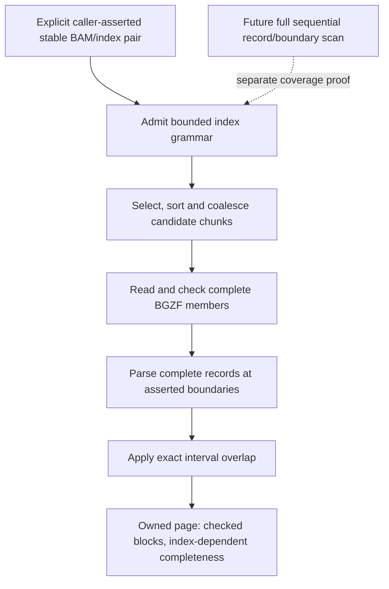

# BAI and CSI: select BAM alignments by reference interval

Status: proposal, 2026-11-06. No regional query, BAI/CSI parser or index-binding guarantee is implemented by this plan.
It extends the sequential [BAM contract](BAM.md); it does not change the current reader's delivery status. The intended
consumer is a viewer asking for alignments overlapping one interval without scanning every earlier alignment.

An index identifies candidate compressed-file ranges. It does not contain the BAM's content digest, establish that it
belongs to these exact bytes, or prove that it includes every matching record. A checked BGZF block proves that the
visited block decodes with its checksum; it does not repair an omitted index chunk. This distinction controls the API.

## First useful contract and trust boundary

Proposed composition, not executable code:

```text
query = await openBamQuery(stableBamSource, stableIndexSource, {
  binding: { kind: 'caller-asserted', bamIdentity, indexIdentity },
  finitePolicy
})
for await (page of query.records({ referenceId: 0, start: 100, end: 200, maxRecords: 20, signal })) {
  show(page.records, page.end, page.work, page.binding, page.completeness)
}
```

Require explicit stable identities for both sources and a caller assertion that this exact index was generated from this
exact BAM. Compare the supplied identities with the borrowed sources before acquisition. A caller can establish that
pairing through its own trusted creation receipt containing both byte digests. Two independently measured digests
identify the inputs but do not themselves establish that the index was generated correctly. Equal filenames, extents,
reference counts, or header dictionaries are insufficient.

The initial result must report `binding: 'caller-asserted'` and `completeness: 'index-dependent'`. Do not name this
binding verified or imply that every wrong index is detectable. In particular, a same-header wrong index can omit a
valid chunk while every visited block passes its CRC. Chunk starts are also asserted record boundaries: valid grammar at
an arbitrary in-block position does not independently prove a genuine record boundary. Unknown or untrusted pairing must
fail before a regional query; callers can still use a complete sequential scan.

A future stronger mode would need a complete sequential scan that checks BGZF, all admitted record grammar, sort order
and genuine record boundaries, then independently validates index coverage against those records. Whole-file hashing or
checksum verification alone is not index-completeness verification. Such a scan has whole-file cost and requires its own
bounded receipt, including both stable identities and the admitted profile. Do not add it implicitly to a fast query or
claim it is implemented by parsing the index.



## Parse the indexes before seeking

BAI stores per-reference bins, virtual-offset chunks and a linear offset table. Its fixed hierarchy uses 16 KiB finest
intervals and a 2^29-coordinate domain. The normative layout and metadata pseudo-bin are in
[SAM/BAM 1.6, indexing section, revision b5341fb](https://github.com/samtools/hts-specs/blob/b5341fb/SAMv1.tex).
Preserve the optional unplaced-unmapped count as bigint. Interpret metadata counts as counts, not seek offsets. Reject
duplicate bins, truncated tables, reversed chunks and unknown trailing data; allow only the documented optional trailer.
Do not require real chunks in different bins to be disjoint.

CSI generalizes the hierarchy through `min_shift` and `depth`, replaces BAI's linear table with per-bin lower offsets,
and carries bounded auxiliary bytes. Start with native-qualified BAM CSI profiles `(14,5)` and `(14,6)` and no auxiliary
data. Other combinations and format-specific auxiliary data must be explicitly refused until separately qualified. The
[CSI specification](https://samtools.github.io/hts-specs/CSIv1.pdf) and
[its source](https://github.com/samtools/hts-specs/blob/master/CSIv1.tex) were inspected on 2026-11-06; acquire an
immutable source revision and byte hash before implementation. The document does not by itself qualify its compression
envelope. [HTSlib 1.25 hts.c](https://github.com/samtools/htslib/blob/1.25/hts.c), notably `hts_idx_save_as` and
`idx_read`, writes BAI uncompressed and CSI through BGZF. Qualify those exact native envelopes; the current BAM-specific
cursor must not silently treat an index as another BAM stream or require a BAM record header.

Use checked bigint arithmetic for uint64 virtual offsets and hierarchy calculations. Separate compressed offset
`virtual >> 16` from in-block position `virtual & 65535`; neither subtraction nor addition of virtual offsets is a
physical byte distance. Check the compressed position against the BAM extent and the low position against the fully
decoded block. A position at a 65,536-byte decoded boundary must normalize to the next compressed block at offset zero;
it cannot be represented by wrapping the low bits. Chunk ends are exclusive. Admit records whose starts precede the
chunk end, and finish each admitted record even if its body crosses that end. Reject truncated crossing records and
invalid seek geometry before exposing a partial record.

Proposed index safety defaults: 8 MiB compressed/source input, 16 MiB decoded index bytes, 4,096 references, 65,536
aggregate bins, 262,144 aggregate chunks and linear entries, 4,096 selected chunks and 65,536 bin-enumeration steps.
Reserve these dimensions before arrays, sorting or enumeration. Keep them separate from BAM source, BGZF/DEFLATE work,
record attempts and returned-storage budgets. All attempts, including unsuccessful queries and restarts, share lifetime
ledgers. Freeze retained index metadata; store chunk pairs contiguously where practical.

## Select records, not just overlapping bins

Start with one explicit reference ordinal and a nonempty zero-based half-open interval `[start,end)`. Reject unknown
references, negative/unsafe coordinates, empty/reversed intervals and queries outside the admitted index domain. Avoid a
SAM region-string parser in the first slice; names may contain colons. Convert native fixture commands to one-based
inclusive coordinates explicitly.

Enumerate overlapping bins, apply qualified BAI linear/CSI lower-offset pruning, sort candidate chunks by virtual
position and merge overlaps or adjacent ranges. Only coalesce gaps under an explicit bounded read-cost policy. Decode
coalesced ranges once and retain physical source order. Deduplicate a record reached through overlapping chunks by its
starting virtual offset, never its name or content: distinct identical reads must both survive. Start with one interval;
multiple-region union, mate fetching and their duplicate policies are separate capabilities.

Match HTSlib's interval rule: include the record when its reference matches and its effective interval overlaps the
query. Derive reference length from `M,D,N,=,X`, not query-consuming operations; a query inside a deletion or skipped
reference span still overlaps the alignment envelope. Use an effective reference length of one when reference
consumption is zero. For placed unmapped records, HTSlib also uses length one, regardless of CIGAR. These semantics come
from [`bam_endpos` in HTSlib 1.25 sam.c](https://github.com/samtools/htslib/blob/1.25/sam.c), and must receive native
controls. Keep placed unmapped reads eligible for their reference interval. Unplaced `referenceId:-1` reads are excluded
from regional results. A later explicit unmapped-tail operation must not confuse the metadata count with a location.

Require coordinate-sorted input as part of the caller assertion. Validate local order while traversing visited records,
but report that this does not prove global ordering of unread bytes. Never use a locally observed coordinate to skip
unread chunks unless the qualified sorting/index contract permits it. Reaching `maxRecords` remains a preview stop with
no next-record probe. Exhausting selected chunks means `index-exhausted`, not physical EOF or independently complete
regional coverage. Without a full coverage receipt, even an empty result stays index-dependent.

## Native proof before a production query API

Reuse the already admitted Samtools 1.25 complete release and bundled HTSlib from
[`tests/fixtures/bam/create.ts`](../../tests/fixtures/bam/create.ts). Its four preserved prefix fixtures are not indexed
proof and must stay byte-identical. Add separate authored coordinate-sorted SAM originals and a distinct producer
profile. No extra production dependency or Python program is needed. Run only in the existing isolated, offline, 1 GiB
single-job native lane with fresh evidence destinations and bounded subprocess/file diagnostics.

1. Author sorted originals with two references, equal-position reads, identical reads at distinct virtual offsets, 16
   KiB boundary cases, a long reference-spanning alignment, `D/N`-only overlap windows, zero-reference-span CIGAR,
   placed unmapped records, unplaced tail records and an alignment crossing BGZF boundaries. Set `SO:coordinate` in
   these new originals. Native indexing must reject a separately authored out-of-order input; a header declaration is
   not the sort oracle.
2. Produce BAM with `samtools view --no-PG -b -o query.bam original.sam`; compare full native `view --no-PG -h` output
   with the authored original. Create explicit indexes with `samtools index -b -o query.bai query.bam` and
   `samtools index -c -m 14 -o query.csi query.bam`. Inspect and retain actual CSI parameters. Add a reference and a
   mapped record beyond 2^29 for the CSI-only case; BAI refusal and CSI success are distinct controls. The
   [Samtools 1.25 index manual](https://www.htslib.org/doc/samtools-index.html) defines these operations.
3. Freeze an authored expected SAM string for every selected interval before executing native queries. Require full
   equality from `samtools view --no-PG -h -X query.bam query.bai chr1:101-200` and the corresponding CSI command.
   Include empty matches and overlap boundaries. The [view manual](https://www.htslib.org/doc/samtools-view.html)
   documents explicit-index selection and unmapped behavior. Never substitute a count or regenerate expected lines from
   the candidate. Samtools writing/indexing/querying shares HTSlib: label this independent-from-candidate, same-library
   proof.
4. Build a second BAM with the same dictionary and valid BGZF but changed record placement/block geometry. Retain its
   native index. Test trusted-pair digest mismatch refusal, malformed chunk bounds and wrong-reference counts. Also
   retain a same-header syntactically valid index with an omitted chunk: full authored expected results must expose the
   omission during qualification. Runtime parsing cannot universally detect that omission, so the API must retain its
   index-dependent label when the caller supplies a false assertion. Do not turn this control into an impossible promise
   to reject all wrong indexes.
5. Candidate gates must compare every returned field with native/authored originals, prove physical read reduction for a
   late interval, and cover overlapping/duplicate chunks, pseudo-bins, absent optional counts, zero linear entries,
   maximum/minimum virtual positions, crossing records, empty interior BGZF blocks, truncation and budget-before-
   allocation. Include cancellation during index and BAM reads, exact raw failure reasons, early return, stable owned
   values, and shared lifetime exhaustion. Both sources remain borrowed and never close implicitly.

Implement in small steps: independent indexed corpus; pure BAI grammar and chunk planner; bounded BGZF seek contract;
BAI query composition and native candidate comparisons; then CSI envelope/grammar and equivalent comparisons. Keep
private files under `src/dataset/bam/` and expose only a qualified consumer operation through `./dataset/bam`. Benchmark
late-region index acquisition plus all selected decode work against a bounded full sequential scan. Report source/index
bytes, requests, decoded blocks, records and output storage; do not compare an unchecked count with a checked query as
if they performed equivalent work. Public export/type consumers, portable runtime gates and exact-head CI are delivery
gates after those focused proofs. No regional, CRAM, writing or resume support is claimed by this planning artifact.
