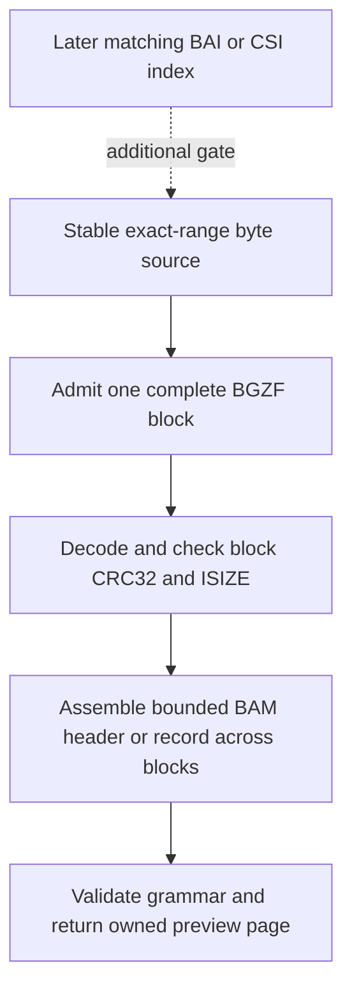

# BAM: preview alignments through bounded BGZF blocks

Status: first bounded sequential profile implemented, 2026-11-06. Focused candidate tests passed on Deno, Node and Bun
in receipt `e1990cbe-7cea-4255-8b5d-4089c5f6aa33`, including full comparisons with four authored SAM originals. The
public `./dataset/bam` entry is wired; installed-package consumers passed in receipt
`eb663979-e1bf-4c92-b91b-b10c3a770916`; exact-head CI remains pending. CRAM, regional indexes and the remaining BAM
profiles are separate work.

The [native fixture recipe](../../tests/fixtures/bam/README.md) passed native Samtools and bundled HTSlib 1.25
production/readback in receipt `86ab95db-79e3-4541-9095-0f171e5ae0f0`. Its hash-pinned corpus retains original text,
native bytes, source identity and proof limits. The preserved `format-bam`, `format-cram` and `codec-bgzf` catalog
records remain separate planning records. This slice follows the dataset-view owner in [GROUPS](GROUPS.md#dataset-view).

A preview should show the header and first few alignments without loading a complete sequencing file. An alignment
describes how one read relates to a reference sequence. BAM stores those records inside independently compressed BGZF
blocks. A record can cross block boundaries, so neither one compressed block nor one network chunk is a record.

Start with a sequential prefix reader over a caller-owned stable byte source. Regional queries need a matching index and
are a later capability. This yields useful previews without pretending that an unverified index can locate every
matching alignment. It is a dataset reader, not a driver, adapter, filesystem projection or alignment-analysis engine.

## First consumer and implementation boundary

The implemented consumer contract uses the following operations; see the [BAM guide](../../docs/bam.md) for a complete
TypeScript example and current support boundaries:

```text
dataset = await openBam(stableSource, finitePolicy)
show(dataset.header.text, dataset.header.references)
for await (page of dataset.records({ maxRecords: 20, signal })) {
  show(page.records, page.work, page.verification)
  break
}
```

Opening validates a bounded header and reference dictionary, and checks the required physical final BGZF marker.
Iteration starts at the first alignment and yields owned bounded pages. Stopping after 20 records does not validate the
unread records. An oversized record or exhausted work budget must fail with its location; `maxRecords` is a deliberate
preview limit, distinct from a safety limit. The result must distinguish preview stop from natural end, with checked
block extents and record counts. Do not return a successful whole-file-verification flag.

The source remains borrowed: neither abort nor early return closes it. Each iterator owns only its decoder work and must
join cancellation and cleanup, preserving the primary reason and independent cleanup failures. Returned arrays and
strings own their data; later reads cannot overwrite them. No import may discover credentials, open files or select a
runtime. A future forward-only stream API would need a separately documented transfer of reader/cancellation ownership.

Proposed ownership is `src/dataset/bam.ts` for acquisition and consumer contracts, private `src/dataset/bam/` modules
for record/header grammar, and a reusable private BGZF module only when its block contract is actually reusable. Do not
add a public BGZF export solely because BAM needs it. Tests and native fixtures belong in `tests/fixtures/bam/`.

## Three validation layers



The format authority is
[SAM/BAM 1.6, specification revision b5341fb](https://github.com/samtools/hts-specs/blob/b5341fb/SAMv1.tex), especially
sections 4 and 5. Keep these checks distinct:

- **BGZF envelope:** parse the gzip extra-field list, find one well-formed `BC` subfield and derive the complete block
  extent from `BSIZE + 1`. Reject duplicate/truncated fields, reserved flags, impossible extents and unsupported header
  variations explicitly. Admit at most 65,536 compressed and 65,536 decoded bytes per block. Decode the complete block
  before releasing bytes and compare its CRC32 and ISIZE. Those checks detect corruption, not authorship.
- **BAM grammar:** validate little-endian lengths, reference IDs, coordinates and every variable-field extent before
  allocation. Records may span several BGZF blocks. Proposed initial values include core fields, read name, CIGAR,
  packed sequence and qualities. Preserve absent sequence/quality distinctly from empty display strings. Preserve
  original flags and ordinal reference IDs. Start auxiliary fields with ordered `A`, integer, `f` and `Z` entries;
  refuse `H`, `B`, unknown encodings and the long-CIGAR `CG` convention until separately qualified. Do not silently skip
  them or guess that a placeholder CIGAR is the real alignment.
- **Index binding:** a later BAI/CSI reader must validate index geometry and its relationship to this BAM snapshot.
  Neither a filename match nor equal reference counts proves that relationship. Virtual offsets are compound
  compressed-block/in-block positions, represented as `bigint`, not ordinary distances. No indexed query is proposed
  until wrong-index and omitted-record controls have a credible completeness contract.

Empty blocks inside a BGZF sequence are not end-of-file. Check physical completion separately, and do not stop at an
embedded empty marker. Require a qualified final-marker policy without describing that marker as proof of intact middle
blocks. Ordinary gzip decoding does not supply block addressing or BAM record boundaries. The existing
[compression stream](../../src/archive/compress.ts) is therefore an input to investigation, not an existing BGZF reader.

Reuse exact-range checks and a shared physical request ledger from [source.ts](../../src/source.ts). The existing
[CRC32 primitive](../../src/archive/record.ts) uses incremental state; its final complement must be applied correctly.
Kafka CRC32C has a different polynomial and cannot replace gzip CRC32. A Web `deflate-raw` decoder is a candidate only
after native fixtures qualify exact input termination, trailing-input rejection, bounded output and retirement across
the supported runtimes. If those properties cannot be established, implement or isolate a checked decoder rather than
claiming that a successful prefix decode validates a complete block.

The [Compression Standard](https://compression.spec.whatwg.org/#supported-formats), inspected 2026-11-06 at source
revision `94b42518d2c2f97e64bd5a483d6deb8c8f14c365`, requires raw DEFLATE to reject input after the final block and gzip
to accept exactly one member with correct CRC32/ISIZE and no trailing input. The initial admission proposal submitted
**one entire admitted BGZF gzip member** to the native gzip codec, then independently checked its BGZF header, extent,
decoded ceiling, CRC32 and ISIZE. Runtime admission failed below, so production cannot rely on this route across the
supported runtimes. Never submit the complete concatenated BGZF file to a single-member decoder. A raw-DEFLATE route
also needs exact termination, not just a matching trailer.

`CompressionFrame` in the current compression stream independently checks the final gzip trailer against aggregate
output. It does not locate the DEFLATE end or establish single-member consumption. A leading empty gzip member followed
by a valid member can leave the same output and final trailer, so those independent checks alone cannot detect it.
Existing generic gzip tests are useful regression coverage but do not settle this specific admission.

The source-only [codec admission tests](../../tests/fixtures/bam/codec.test.ts) add stored/fixed authored bytes, a
native Node-zlib dynamic block with its actual BTYPE asserted, complete single-member framing, empty-member
concatenation in both orders, raw trailing input, an extra empty DEFLATE stream inside one member, truncation, CRC/ISIZE
corruption, abort and consumer cleanup. Node's permissive `gunzip` is explicitly not the oracle for WHATWG's stricter
single-member rule. Test expectations come from authored originals and normative refusal rules, never candidate output.
Runtime admission receipt `21ea69aa` records Node passing all six tests, Deno accepting empty truncated raw input, and
Bun accepting a forbidden trailing/concatenated-input control. The original Bun diagnostic did not identify the exact
vector; the maintained tests now label every refusal with its input and chunk sizes. These remain diagnostic admission
tests, separate from the required passing regression suite. Their expectations have not been weakened. Block CRC/ISIZE
alone cannot repair those consumption gaps.

The source-only fallback extracts the existing owned MSZIP RFC 1951 core into `src/archive/deflate.ts`. It checks exact
final-byte consumption, permits zero through 65,536 decoded bytes, and retains a caller-owned per-block work ledger.
MSZIP keeps its CK framing, positive-size 32 KiB output limit and 32 KiB folder history. A future BGZF wrapper must
admit one bounded member, pass empty history for every member, then verify its CRC32 and ISIZE. Focused native-zlib and
authored controls cover output boundaries, history, padding, trailing input and cancellation. Receipt
`11125dad-bb4b-49c0-8b49-3e98a3fded2d` passed all 32 selected tests on Node and Bun. Deno passed CAB and Netlify
controls but its native zlib dictionary oracle refused the history vector after the candidate full-byte assertion had
passed. The Node-only external oracle is now separate from the unchanged portable candidate assertions; the revised
split passed in receipt `3e038fe0` (Deno/Bun 30 selected tests, Node 31 including its dictionary oracle). The first
BGZF-backed BAM reader then passed focused candidate tests in `e1990cbe-7cea-4255-8b5d-4089c5f6aa33`.

Proposed default policy: 1 MiB header text, 4,096 references, 1 MiB per record, 64 KiB per BGZF decoded block, 64 MiB
aggregate source bytes, 64 MiB aggregate decoded bytes, 4,096 requests/blocks, 1,024 records and 8 MiB retained page
output. These are separate implementation limits, not format maxima. Admit counts, CIGAR operations, auxiliary entries,
strings, pages and decoder work independently; a byte ceiling alone does not bound millions of tiny objects. Limits
persist across opening and iteration. Source and header identity do not establish biological correctness.

## Independent native fixture before production code

Use official [Samtools 1.25](https://github.com/samtools/samtools/releases/tag/1.25) with its bundled HTSlib, retaining
the release source archive, licenses, immutable tag/commit identity and measured SHA-256. The release page explicitly
distinguishes the complete release archive from incomplete GitHub-generated source downloads. Inert acquisition receipt
`3724b28e` measured the complete 9,521,878-byte archive against the release API's published SHA-256 frozen in
`artifacts.ts`. This admits archive identity only. The bundled source inventory, licenses and build recipe still require
review before execution. An independently acquired
[HTSlib 1.25 release](https://github.com/samtools/htslib/releases/tag/1.25) is an alternative, not an unrecorded
replacement for the bundled library.

A maintained TypeScript acquisition/producer launcher should use Node built-ins, fresh `wx` evidence destinations,
bounded archives/files/transport, SIGKILL deadlines and joined child cleanup. Build the native programs offline in the
existing root-owned isolated qualification lane: pinned image, 1 GiB memory/swap, CPU 1, PID 256, no execution-time
network and bounded diagnostics. No Python, package-install hook or candidate parser may produce expected values.

Author complete SAM originals, then use `samtools view --no-PG -b` to produce BAM and `samtools view --no-PG -h` for
full native readback. Compare every admitted field, sequence byte and quality byte with authored originals; do not use a
count as the oracle. The [view manual](https://www.htslib.org/doc/samtools-view.html) defines these conversion
operations. The native writer/reader share HTSlib, so label this independent-from-candidate, same-library proof. Use
[bgzip](https://www.htslib.org/doc/bgzip.html) full decompression/integrity checks as an additional block control. Never
substitute [quickcheck](https://www.htslib.org/doc/samtools-quickcheck.html) for complete readback: it deliberately
skips the middle of a file.

Native receipt `86ab95db-79e3-4541-9095-0f171e5ae0f0` qualified all four authored SAM profiles through Samtools and
bundled HTSlib 1.25, with complete original text readback and `bgzip -t`. The 160,000-base case contains six native BGZF
blocks and one record crossing block boundaries. This does not qualify a candidate BAM reader.

The corpus must cover header-only, no-reference unmapped, multiple references, mapped/unmapped reads, missing quality,
empty sequence, ambiguous packed bases, CIGAR operations, admitted auxiliary values and records crossing block
boundaries. Produce large crossing records from authored SAM and verify their actual native block geometry; do not
assume the compressor cuts at a chosen position. Keep raw artifacts and receipts hash-pinned and exempt from text
conversion. Native `bgzip` levels 0 and default should exercise stored and compressed blocks where actually observed.

Authored negative controls then alter BC/BSIZE/CRC/ISIZE, compressed termination, marker placement, reference IDs,
record extents, CIGAR lengths, sequence/quality lengths, auxiliary termination and unsupported profiles. Add
cancellation, exact raw failure reasons, cleanup failure, stable returned values, tiny-chunk work bounds and
budget-before-allocation tests. Native refusal is separate evidence from a candidate refusal; report when only the
authored control was run.

## Gates after a prefix preview

Publish a proposed `./dataset/bam` entry only after strict source checks, complete native-original candidate
comparisons, portable corruption/lifetime tests and extracted Node/Deno/Bun consumers pass. Benchmark
header-plus-20-record previews against native decode with source bytes, decoded blocks, retained output and units; do
not infer performance from file size. CI at the exact pushed commit is an additional delivery gate.

BAI then CSI regional queries require coordinate ordering, chunk coalescing, overlapping-read selection, duplicate
suppression, unmapped placement, source/index identity and completeness evidence. The
[CSI specification](https://samtools.github.io/hts-specs/CSIv1.pdf) is a separate grammar. A GZI block-offset index is
not a genomic-region index. Resume checkpoints, writing, long CIGAR, remaining auxiliary types and second-engine
interoperability remain explicit follow-up capabilities.

CRAM remains another pending format. Sharing alignment concepts does not implement its reference retrieval, versioned
codecs or checksum contracts. It needs a separate plan with explicit caller-supplied reference identity and native
fixtures; no ambient reference download or CRAM support claim belongs in the BAM prefix slice.
