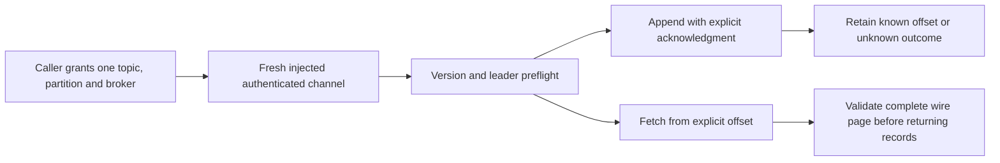

# Kafka: one explicit partition

Status: first public client profile implemented, 2026-11-06. The optional `./kafka` entry now supplies the explicit
partition contract below. Deno record/session controls and fresh Java/candidate full-byte interoperability passed for
one plaintext broker; TLS/SASL, multiple brokers, allocation measurements and current release package/CI gates remain
separate. This slice advances catalog record `log-kafka` under `record-store`; it introduces no filesystem driver or
adapter and does not complete that group. See the [consumer guide](../../docs/kafka.md).

The caller wants to append binary records, retain acknowledged offsets, and read a bounded page from an explicit offset.
Offsets are positions in a retained log. Reading does not dequeue, retention/compaction can remove records, and an
all-ISR acknowledgment is not a guarantee of indefinite retention or replicated durability on a one-node fixture.

## Implemented first contract

The optional `./kafka` exposes a `KafkaClient` configured for one topic, partition, expected broker ID and an injected
fresh exclusive channel opener. The opener owns abort-aware transport acquisition, TLS/peer verification and any SASL
handshake, and transfers an already authenticated request-boundary stream. Plaintext requires explicit caller policy.
The library owns retirement of the transferred channel. It discovers no host sockets, globals, credentials or brokers.

The operations are `metadata()`, `offset('earliest' | 'latest')`, `append(records)` and `fetch(offset, options)`.
Use the independently exercised fixed versions: ApiVersions0, Metadata4, Produce3, Fetch4 and ListOffsets1. Check
version support and the configured partition leader on the same owned channel before Produce dispatch. Report advertised
endpoints as untrusted metadata; never auto-dial or forward credentials to an advertised host. A moved leader requires
an explicit new caller decision, with no automatic retry or refresh loop.

Records retain nullable binary key/value, ordered duplicate headers and explicit timestamps. Null and empty bytes are
different. Offsets and timestamps remain bigint within their signed int64 profile. Copy admitted mutable inputs before
the first await. Produce one uncompressed nontransactional magic-2 batch with non-idempotent sentinel IDs and acks=-1.
Preserve native errors, throttle time, base offset, count and append-time sentinel/evidence in the receipt.

Once Produce is handed to the transport, loss of a complete acknowledgment yields `KafkaOutcomeError` with an unknown
append outcome. A blind retry may duplicate data. If a complete acknowledgment exists and cleanup subsequently fails,
`KafkaCompletionError.receipt` must preserve that known result. This follows the existing AMQP result/cleanup model.

Fetch validates the entire admitted wire page before publishing any records. If the page exceeds record policy, reject
all of it: return neither a truncated prefix nor an invented cursor. Count wire records/bytes before filtering offsets
older than the requested position. Advance only from the fully validated batch's native last-offset boundary, without
regressing the requested cursor; compaction can leave gaps and empty batches. Retain high-water mark and native
partition errors as separate observations. An empty page is a point-in-time result, not permanent EOF. Only the
explicitly nontransactional read_uncommitted profile is in scope; compressed, transactional, control and unsupported
batch attributes refuse.

Implementation safety ceilings, independent of broker limits: 1 MiB aggregate complete serialized record bytes; 1024
records; 64 headers per record and 1024 headers total; 4 MiB request/response frame; 8 MiB whole-call I/O; 64 KiB
retained transport chunks. Header names and values count toward admission. Allocation accounting must confirm these
bounds before code is accepted; valid CRC32C never excuses malformed lengths, varints, counts or offset arithmetic.

CRC32C can reuse the reviewed MIT project-owned utils checksum source, whose inspected SHA-256 is
`8272b3851e3b5b6b20d3ef5ba0e7d33c603e250915bf53b87b27422937e30fef`, as an attributed internal pure module. Do not add
unresolved `@okikio/hash` version `0.0.0` or its unrelated package dependency closure. This is a reviewed source-reuse
direction, not a claim that a published dependency has been installed or qualified.

## Lifecycle, result and parsing decisions

The implementation reader should be able to trace one append without guessing who closes a socket or whether an error
permits a retry. Use `src/amqp.ts` and `src/nats.ts` as the lifecycle reference, and their cancellation/cleanup tests as
behavioral precedents. Reuse the contract, not a transport pool: each Kafka call acquires a new exclusive channel,
serializes its requests, accepts no unsolicited frames, and retires that channel before it settles. Concurrent calls may
acquire different channels; they share no session, correlation counter or background refresh task.

The opener receives the combined caller/client/deadline signal. It owns any partially acquired or late channel until a
successful ownership transfer; its contract must require retirement when cancellation wins acquisition. After transfer,
the client binds `close` before inspecting other channel properties. Closing is idempotent and must retire pending reads
and writes. A foreign promise remains observed after cancellation. Cleanup has an independent bounded deadline so an
aborted request cannot skip retirement. Release stream locks after attempting channel retirement, collecting every
cleanup failure. Defaults should match the current clients: 30 s operation deadline (at most one day), 5 s cleanup (at
most one minute), with no detached work hidden behind a successful result.

Use this append state table in tests and TSDoc. A complete broker response and a successful append are distinct facts.

| Last established fact                                                                         | Result and caller recovery                                                                                                                                                                             |
| --------------------------------------------------------------------------------------------- | ------------------------------------------------------------------------------------------------------------------------------------------------------------------------------------------------------ |
| Input invalid, acquisition/preflight failed, or cancellation observed before Produce dispatch | Ordinary local/protocol error; this call sent no Produce.                                                                                                                                              |
| Produce handed to `writer.write`, including a synchronous throw or partial write              | Mark dispatch before invoking the foreign writer; without an admitted complete response, throw `KafkaOutcomeError` with `outcome: 'unknown'`.                                                          |
| Complete, matching Produce3 response with error code zero                                     | Retain the acknowledged base offset/count, native append-time value and throttle observation as a receipt before checking subsequent abort or cleanup.                                                 |
| Complete, matching response with a nonzero native error                                       | Preserve the native error code and response evidence. Do not infer that nothing was appended from the existence of an error response; retry disposition needs the verified error classification below. |
| A retained successful receipt followed by abort or retirement failure                         | Throw `KafkaCompletionError` carrying that receipt and failure evidence. The caller can retain the acknowledged offsets.                                                                               |

Never insert topic names, broker hosts, keys, payloads or server-controlled strings into automatic error messages. Keep
numeric native codes and explicit operation/result fields inspectable. A caller may log those fields under its own
policy. Preserve the primary error and cleanup failures together; cleanup must not replace an unknown append outcome. No
automatic retry is permitted, including retry after a leader or request-timeout error.

`metadata()` sends ApiVersions0 and a single-topic Metadata4 request with auto-creation disabled. The other operations
perform version and leader preflight on their own newly owned channel; preflight is an observation, not a lease that
prevents a later leader change. ListOffsets1 uses consumer replica ID -1 and exactly one partition. Fetch4 uses consumer
replica ID -1, isolation level 0 and exactly one partition. Require exactly the requested topic/partition in partition
responses, bounded distinct broker IDs in metadata, a known configured leader, valid port ranges, strict UTF-8, explicit
nullable strings and complete frame consumption. Metadata4 provides no leader epoch; Fetch4 provides no log-start
offset. Do not fabricate those newer-version fields. Preserve returned replica and ISR lists without treating them as
proof of future durability. See the retained
[Metadata4](../../tests/fixtures/kafka/history/MetadataResponse.json.snapshot),
[Fetch4](../../tests/fixtures/kafka/history/FetchResponse.json.snapshot) and
[Produce3](../../tests/fixtures/kafka/history/ProduceResponse.json.snapshot) primary schemas.

Integer parsing must distinguish lengths from values. Signed int32 frame/array/string lengths are checked before
allocation or iteration, including sentinel -1 only where that exact schema allows null. Counts also need enough
remaining bytes for their minimum element size. Signed int64 offsets/timestamps stay bigint through parsing,
comparisons, arithmetic and receipts. No `Number` conversion is allowed for them. Decode zigzag int32 and int64 with
separate 5-byte and 10-byte ceilings, final-byte overflow checks and signed-range checks. Encoder output is minimal;
accepting other valid encodings requires a primary-source decision rather than copying the fixture decoder's
permissiveness.

Nullable keys, values and header values remain `null` or separately owned bytes, with zero-length bytes preserved.
Header names are non-null strict UTF-8 strings, and order/duplicates remain visible. Snapshot input arrays and nested
bytes before the first await; returned bytes must not retain an entire response buffer or alias mutable transport
chunks. Explicit CreateTime input timestamps are nonnegative signed int64 values; subtraction and reconstruction use
checked bigint arithmetic. The initial broker LogAppendTime restriction is specified below.

The [Kafka record format](https://kafka.apache.org/44/implementation/message-format/) establishes the CRC32C scope from
attributes to batch end. Base offset and leader epoch lie outside it and need independent validation. Compaction retains
batch offset boundaries and may leave empty batches, so record count cannot determine the next offset. Restrict this
profile to magic 2, no compression, and no transactional, control or delete-horizon flags. Check every batch and record
extent, reserved attribute, offset delta and timestamp before returning any page. CRC agreement alone establishes none
of those invariants.

Fetch admission applies to the whole native page before filtering older offsets. Keep the requested offset for a page
with no admitted batch; otherwise derive the next offset from the greatest validated batch boundary without regressing
the requested offset, with checked signed-int64 successor arithmetic. Never wrap the maximum offset, infer a cursor from
high watermarks, or invent one from returned record count. Require monotone batch boundaries and unique increasing
record offsets within them; compaction gaps remain allowed. A safety-limit failure returns no records or cursor. In
particular, advertised fetch byte limits are request policy, not a bound on a broker response: the pinned Fetch schema
explicitly points to KIP-74 exceptions. The 4 MiB wire ceiling must therefore be independently enforced and reported as
this client's safety limit.

Implement an allocation ledger before accepting the proposed ceilings. Count preflight, request and response traffic
against the whole-call budget; check frame prefix before body allocation; cap retained borrowed chunks and copy them.
Bound zero-length chunk progress, counts, request serialization, record/header copies and result retention separately. A
metadata response can exceed this profile even when a single record fits it. A broker response above the ceiling must
terminate the owned channel without draining an unbounded body. Qualification should measure peak retained bytes under
worst-case admitted frames and narrow documented claims to what those measurements prove.

## Resolved protocol decisions and remaining execution proof

The following decisions use Apache Kafka commit `1156b2752aaa28eafc0b4c4d387e63356793268d`, the same revision recorded
by the retained 4.4.0 attribution receipt. The referenced sources were read without executing them. Record parser
implementations are under `common/record/internal/` at this revision. These source findings settle the initial profile;
they do not themselves qualify the client or replace native control cases.

**A native error response does not necessarily mean rejection.** Pinned
[`Errors.java`](https://github.com/apache/kafka/blob/1156b2752aaa28eafc0b4c4d387e63356793268d/clients/src/main/java/org/apache/kafka/common/protocol/Errors.java#L223-L226)
distinguishes insufficient replicas before append (19) from insufficient replicas after append (20).
[`Partition.scala`](https://github.com/apache/kafka/blob/1156b2752aaa28eafc0b4c4d387e63356793268d/core/src/main/scala/kafka/cluster/Partition.scala#L1219-L1252)
checks minimum ISR before writing for acks=-1, while its
[acknowledgment check](https://github.com/apache/kafka/blob/1156b2752aaa28eafc0b4c4d387e63356793268d/core/src/main/scala/kafka/cluster/Partition.scala#L950-L982)
can return error 20 after the local append. The chosen conservative initial API classifies **every dispatched nonzero
Produce response as unknown mutation outcome**, retaining the complete native response/code in `KafkaOutcomeError`. This
is a client restriction, not a claim that error 19's documented server path writes data. No error-code allowlist, retry
or claim of exactly-once delivery is needed. Timeout, missing response, wrong correlation, malformed response, leader
movement and cleanup before successful receipt admission remain unknown. Error zero alone admits a successful receipt
after all lengths/topology/offsets are validated. Acks=-1 concerns the ISR acknowledgment condition at that time; it
does not promise disk fsync, future retention or more than one copy in the single-node fixture.

**Null records and an empty record set are both valid empty pages.** The retained Fetch4 schema marks `Records`
nullable; pinned
[`FetchResponse.recordsOrFail`](https://github.com/apache/kafka/blob/1156b2752aaa28eafc0b4c4d387e63356793268d/clients/src/main/java/org/apache/kafka/common/requests/FetchResponse.java#L206-L218)
normalizes null to `MemoryRecords.EMPTY`. Accept length -1 and length 0 only after validating the containing successful
partition response, preserve their wire distinction as receipt evidence, return no records and retain the requested
cursor. Other negative lengths refuse. A partition error remains an error even if its records are null/empty. Neither
form is permanent EOF or permission to advance to the high watermark.

**Reject an incomplete final batch as a profile limit, not as proof of an invalid Kafka server.** Pinned
[`ByteBufferLogInputStream.nextBatch`](https://github.com/apache/kafka/blob/1156b2752aaa28eafc0b4c4d387e63356793268d/clients/src/main/java/org/apache/kafka/common/record/internal/ByteBufferLogInputStream.java#L41-L85)
stops iteration when the remaining bytes cannot contain the next declared batch. Apache's
[KIP-283](https://cwiki.apache.org/confluence/spaces/KAFKA/pages/75979691/KIP-283%2BEfficient%2BMemory%2BUsage%2Bfor%2BDown-Conversion)
also describes partial padding batches during down-conversion. Our initial magic-2-only client requires exact record-set
consumption and rejects the **whole page**, including any complete prefix, on any incomplete tail. It returns no cursor
or records. The caller can change its explicit limits or select a separately qualified client profile; there is no
automatic re-fetch loop. Fetch byte limits are soft server request policy; this client's frame allocation ceiling
remains hard even for an oversized first batch allowed by KIP-74. Native tests must show the public failure identifies
an unsupported page profile rather than reporting a false CRC or silently dropping bytes.

**Compaction can remove all records without removing batch offset boundaries.** Pinned
[`DefaultRecordBatch`](https://github.com/apache/kafka/blob/1156b2752aaa28eafc0b4c4d387e63356793268d/clients/src/main/java/org/apache/kafka/common/record/internal/DefaultRecordBatch.java#L73-L95)
retains first/last offset information; an empty batch has base timestamp -1 and retains its prior maximum timestamp.
[`CompletedFetch`](https://github.com/apache/kafka/blob/1156b2752aaa28eafc0b4c4d387e63356793268d/clients/src/main/java/org/apache/kafka/clients/consumer/internals/CompletedFetch.java#L184-L200)
advances using the final batch boundary, and
[`AbstractRecordBatch.nextOffset`](https://github.com/apache/kafka/blob/1156b2752aaa28eafc0b4c4d387e63356793268d/clients/src/main/java/org/apache/kafka/common/record/internal/AbstractRecordBatch.java#L26-L29)
defines its successor as last offset plus one. Therefore accept a fully validated zero-record uncompressed batch with
nonnegative offset bounds even when its base timestamp is -1. Do not apply nonempty record timestamp rules to that
sentinel. Record deltas may have gaps and need not start at zero or end at `lastOffsetDelta`; require them to be
strictly increasing within that declared boundary. Compute `nextOffset = max(requestedOffset, greatestBatchLast + 1)`
only after the whole page passes. Reject a batch whose checked last-offset addition or successor exceeds signed int64.
That overflow rejection is our explicit safety restriction; never reproduce Java long wraparound or regress a cursor.
The no-delete-horizon/no-transaction/no-control restriction still applies, including empty batches.

**ListOffsets1 latest is already a boundary; never add one.** With consumer replica ID -1, the server passes the default
read-uncommitted isolation into
[`ReplicaManager.fetchOffset`](https://github.com/apache/kafka/blob/1156b2752aaa28eafc0b4c4d387e63356793268d/core/src/main/scala/kafka/server/ReplicaManager.scala#L1483-L1496).
[`Partition.fetchOffsetForTimestamp`](https://github.com/apache/kafka/blob/1156b2752aaa28eafc0b4c4d387e63356793268d/core/src/main/scala/kafka/cluster/Partition.scala#L1439-L1477)
uses the high watermark for this client case, rather than its unreplicated log end. ListOffsets1 does not carry an
isolation field or leader epoch. For earliest/latest responses, admit a successful nonnegative signed-int64 offset
unchanged, including `9223372036854775807n`; retain timestamp -1 as the native special-query sentinel. Fetch may accept
that maximum value as a requested offset without incrementing it. It must refuse an actual returned batch requiring an
unrepresentable successor. Error responses may carry offset -1; preserve it as native failure evidence and never expose
it as an admitted cursor. Do not conflate ListOffsets latest, observed high watermark, last record offset and next
offset after a specific page. Add all four boundary cases to pure tests.

**ApiVersions0 has one exact parser even on error.** The [protocol guide](https://kafka.apache.org/40/design/protocol/)
describes unsupported-version responses using v0. Pinned
[`ApiVersionsResponse.parse`](https://github.com/apache/kafka/blob/1156b2752aaa28eafc0b4c4d387e63356793268d/clients/src/main/java/org/apache/kafka/common/requests/ApiVersionsResponse.java#L154-L169)
fallback only matters when the attempted parser version is nonzero. This client sends v0, so parse the classic response
header/correlation, int16 error and bounded array of API/min/max triples, then require exact consumption. There is no v0
throttle field, flexible header or tagged tail. Parse the complete array even on error, retain it as failure evidence
and refuse the operation on every nonzero code, including UNSUPPORTED_VERSION(35). Never interpret that error's list as
successful full capability discovery or retry another version. On zero error, accept additional well-formed distinct
nonnegative API keys beyond those used by this client, while requiring each chosen version to fall within its advertised
range. Reject duplicate keys, negative/inverted ranges, missing required APIs and trailing bytes. Missing v0 support or
socket closure is an unsupported peer, not a prompt to send Produce blindly.

**Initial timestamp support remains explicit CreateTime reads.** Produce3 acknowledgment can report a native
LogAppendTime value instead of sentinel -1; return that successful acknowledgment with its native timestamp mode
observation rather than rejecting a known append. Fetch initially admits CreateTime batches only and refuses the whole
page for LogAppendTime attributes. This is an implementation restriction, not a statement that Kafka lacks append-time
support. The official batch source above describes broker-set maximum timestamps; a later read profile must qualify its
exact per-record reconstruction against Java. Never claim supplied CreateTime values survived broker rewriting.

Execution evidence now includes independent stable one-broker Metadata4 success semantics, Deno record/session
controls and fresh byte-for-byte Java/candidate interoperability. Their exact scopes are recorded below. Allocation
measurements, other runtime/package/CI gates and broader native topologies remain separate; source research alone
passes none of them.

## Historical originals and their Metadata4 gap

[Retained native evidence](../../tests/fixtures/kafka/README.md) records official Java append offsets 0/1/2, independent
literal append offsets 3/4/5, complete 128 KiB/null/empty/header/timestamp comparisons, and JDK builtin CRC32C
agreement. The broker run exited successfully without OOM or fixture cleanup failures. The original outer terminal
remains failed because the verifier expected a display name where Java emitted `Enum.name()`; a separately retained
semantic recovery qualified the unchanged original bytes. No candidate code was imported. That is independent oracle
qualification, not public client or CI qualification.

**The original corpus captured Metadata4 and checked correlation/framing, but did not independently decode semantics.** Before leader
preflight is trusted, implement its version-specific broker/rack/cluster/controller/topic/partition/replica/ISR parser
against the pinned primary schema. Add original-native semantic assertions and adversarial duplicate, missing leader,
wrong topic/partition, count/UTF-8/range/trailing-byte cases. Do not infer that metadata semantics passed because append
and fetch did. The later independent Metadata4 corpus below closes the stable success-observation portion without
rewriting the original receipt's `metadataSemanticClaim: false` result.

## Independent Metadata4 qualification recipe

The separately qualified tools are `tests/fixtures/kafka/metadata.ts` and
`tests/fixtures/kafka/oracle/AdminMetadataOracle.java`; the completed native run is recorded below. The decoder imports
no candidate parser and does not share the production client's semantic implementation. It
reads one complete length-prefixed Metadata4 frame, verifies its correlation and exact extent, then retains native
errors, broker IDs/hosts/ports/racks, nullable cluster ID, controller ID, topic/internal flag, and
partition/leader/replica/ISR fields. Bounded counts, duplicate IDs/names/partitions, strict UTF-8, null sentinels,
booleans and trailing bytes are explicit. It preserves native error -1 and unknown leader/controller -1 rather than
treating them as malformed lengths. The decoder does not claim an error-free configured leader merely because syntax
passed. Controller ID membership in the broker array is not a syntax requirement: controller and broker roles can
differ.

The new authored Java harness uses the admitted **public** `AdminClient.create(Properties)`, `describeCluster()` and
`describeTopics(...).allTopicNames()` APIs on the same configured topic/partition. Exact APIs were inspected at the
retained SDK source revision:
[AdminClient](https://github.com/apache/kafka/blob/1156b2752aaa28eafc0b4c4d387e63356793268d/clients/src/main/java/org/apache/kafka/clients/admin/AdminClient.java#L33-L43),
[Admin](https://github.com/apache/kafka/blob/1156b2752aaa28eafc0b4c4d387e63356793268d/clients/src/main/java/org/apache/kafka/clients/admin/Admin.java#L291-L357),
[TopicDescription](https://github.com/apache/kafka/blob/1156b2752aaa28eafc0b4c4d387e63356793268d/clients/src/main/java/org/apache/kafka/clients/admin/TopicDescription.java#L106-L128),
and
[TopicPartitionInfo](https://github.com/apache/kafka/blob/1156b2752aaa28eafc0b4c4d387e63356793268d/clients/src/main/java/org/apache/kafka/common/TopicPartitionInfo.java#L83-L104).
Reuse the exact admitted five-JAR classpath and separately qualified JDK; no Maven/Gradle resolver, additional SDK or
production dependency is introduced. Compilation and execution remain root-owned serial qualification steps.

The owner should run the following sequence inside the existing resource envelope, with fresh retained output files:

1. Testcontainers starts the exact admitted broker with the bounded original config, JVM/data/log/tmpfs limits and
   dynamic listener. Use a finite log wait for the standard INFO text `Kafka Server started`, emitted by pinned
   [KafkaRaftServer.startup](https://github.com/apache/kafka/blob/1156b2752aaa28eafc0b4c4d387e63356793268d/core/src/main/scala/kafka/server/KafkaRaftServer.scala#L92-L100)
   after both role startups; its
   [constant](https://github.com/apache/kafka/blob/1156b2752aaa28eafc0b4c4d387e63356793268d/core/src/main/scala/kafka/server/KafkaBroker.scala#L64-L72)
   deliberately supports Kafka system-test readiness. Preserve logs on failure. Do not replace the wait with a polling
   loop or infer that the marker proves topic existence, authorization or Metadata4 semantics.
2. Create/confirm the owned topic through the separately bounded existing native fixture flow. Do not overlap auxiliary
   JVMs. Capture the literal Metadata4 response, then run the Admin oracle against the same stable topic/listener and
   partition, retaining source/binary hashes, command, exit status, duration and raw output. Repeat the literal capture
   after Admin if needed to distinguish cluster change from a decoder disagreement; a mismatch never silently retries.
3. Compare cluster ID, broker tuple sets and the exact topic name/internal flag and configured partition. Preserve
   replica assignment order; compare ISR as a set because its public SDK order is unspecified. Compare leader ID and
   partition membership. Admin can describe all partitions even when only one was requested for selection, so match by
   index.
4. Add authored decoder controls for every primitive/truncation point, positive and negative null sentinels, duplicate
   collections, count allocation, strict UTF-8 (including BOM preservation), flag values, native errors and unknown
   leaders, reordered observations, wrong correlation and trailing bytes. Expected values must be authored or taken from
   the independent native observation, never calculated by the future candidate parser.
5. Keep Metadata4 unqualified until native comparisons, decoder controls, strict types/lint, fixture lifecycle and the
   explicit limits below pass. The old verifier's `metadataSemanticClaim: false` must remain unchanged; write a new
   qualification receipt instead of rewriting its historical terminal or source-map entries.

`AdminMetadataOracle` takes exactly `127.0.0.1:PORT OWNED_TOPIC PARTITION`, where topic starts with `opfs-`. It admits
input before constructing Admin, imposes one 20 s future-observation deadline and separate 5 s close bound, and uses no
JSON dependency. Its output is at most 1 MiB, buffered until complete so serialization cannot publish a partial success
envelope. JVM/network/log/elapsed bounds still belong to the fixture owner: a bounded output does not independently
bound all allocations inside the SDK. Retain stdout as binary and separately bounded stderr; process failure must not be
inferred solely from whether an observation was serialized. No connection or CLI is hidden in `metadata.ts`.

The exact binary output grammar is `AMO1` (uint32 `0x414d4f31`), boolean observation-present, optional observation, then
int32 fault count and fault phase/type strings. The observation is nullable cluster string, controller observation
int32, broker count and broker tuples `(id, host, port, nullable rack)`, topic string, internal boolean, requested
partition int32, partition count and tuples `(index, leader-or-minus-one, replica-count/IDs, ISR-count/IDs)`. Strings
use signed big-endian int32 **UTF-8 byte** lengths, with -1 only for nullable strings; booleans are one byte 0/1 and all
other fields/counts are big-endian int32. Faults are bounded class names, not server messages. There is deliberately no
invented wire error code or throttle field in the Admin envelope. Reject a missing observation, any fault, malformed
field or trailing bytes when admitting a successful native comparison.

The comparison has real limits. Admin uses its own negotiated APIs and multiple observations, not a forced Metadata4
request or atomic snapshot. Success does not expose Metadata4 topic/partition error codes or throttle behavior; authored
wire controls qualify decoding those fields without pretending to be independent broker error evidence. Read internal
flags from `TopicDescription.isInternal()`; never hardcode false because the fixture uses an ordinary topic. Most
significantly, pinned
[DescribeClusterResult.controller()](https://github.com/apache/kafka/blob/1156b2752aaa28eafc0b4c4d387e63356793268d/clients/src/main/java/org/apache/kafka/clients/admin/DescribeClusterResult.java#L55-L63)
documents a **random broker** for `bootstrap.servers`, versus the voter leader for `bootstrap.controllers`. Preserve
that Admin field as a controller _observation_, but do not treat equality on one combined-role broker as independent
multibroker controller qualification. Do not add a controller connection or extra JVM to hide this gap. Wire decoder
syntax, separately configured fixture identity and this degenerate comparison are distinct proof levels. Rack null,
nullable cluster, multiple brokers, leadership changes, real native errors and non-null racks remain separate controls
or future fixture profiles unless actually exercised.

## Reviewed order and completion gates

The fresh 6 November 2026 `tests/fixtures/kafka/native-metadata/` corpus closes the stable one-broker
success-observation portion of step 3. Its complete Metadata4 fields agree with the independent public Admin
observation; native output, resource admission, exact artifacts and source identities are retained separately from the
original corpus. This does not close native refusal semantics, leadership changes or multibroker controller
qualification. The maintained
[`qualify.ts` recipe](../../tests/fixtures/kafka/README.md#repeat-the-independent-metadata4-comparison) describes replay
inputs and failure retention. This remains distinct from the production candidate acceptance below.

The migration gates completed before implementation. Fresh candidate runs on 6 November 2026 now retain local
evidence under `.tmp/implementation/kafka-candidate-native-v1/` and `kafka-candidate-native-v2/`. Both terminal
receipts report `qualified: true`, both directions true and no operation/cleanup failures. The Java producer wrote
three original records for the production client to fetch, then the production client appended three originals for the
Java consumer. Every original key/value/header byte, timestamp and offset agreed, including 128 KiB, null/empty fields
and duplicate ordered headers. The runs took approximately 14.2 and 13.2 seconds respectively; these are fixture
durations, not throughput benchmarks. The second run additionally compared public metadata with independent fixture
observations and checked earliest `0`, latest `3` and final latest `6`, with special-query timestamps `-1`.

Separate isolated Deno `--no-check` record controls passed in receipt
`df287981-946b-4e64-9580-4c61aae01ca3`; session/outcome/ownership controls passed in
`2c2faee8-3e80-4129-9c8c-b5f753f9c9ea`. These exercise portable source, not every runtime or type checking. The
native candidate profile is one plaintext broker and one partition, with non-idempotent uncompressed CreateTime
records. TLS/SASL, multiple brokers, leadership changes and replicated durability are not qualified by it. Keep
allocation measurements, packed consumers and current release CI as separate gates.

The original ordering remains the acceptance checklist; the scoped results above close only the checks they exercised:

1. Finish current migration type, runtime, native and CI gates on the same branch/PR.
2. Qualify the typed independent manifest/probe/verifier against frozen originals, preserving previous Python snapshots
   and Java/artifact attribution. Promote no SDK JAR into production or the public package.
3. Close Metadata4 semantic qualification; settle exact binary parsing and allocation bounds against primary schemas.
4. Implement the optional native client and pure framing/batch/CRC functions, with no filesystem projection.
5. Replay frozen independent responses, including arbitrary transport boundaries; cover malformed lengths, CRC, varints,
   unsupported versions/flags, leader changes, complete-page overflow, cancellation and unknown append/known cleanup.
6. Repeat Java producer → candidate fetch and candidate append → Java consumer with full original bytes and precise
   timestamps/offsets, including null/empty values, duplicate headers, nonzero offsets and multiple batches.
7. Run portable runtime tests, isolated serial type/package-import checks and relevant bounded benchmarks. Document
   exact work/limits/recovery, update catalog support and release intent, and require same-PR CI before claiming
   support.

Native qualification preserves the proven serial envelope: one exact admitted Kafka JVM image, one 1 GiB memory/swap
ceiling, one CPU, 128 PIDs, broker heap 256 MiB and at most one 128 MiB auxiliary JVM at a time. Data tmpfs stays 32
MiB; additional tmpfs/log/config bounds and fixed five-JAR client classpath remain in the retained recipe. Topic
creation, CLI readiness, oracle and CRC steps are serial. Testcontainers owns lifecycle, dynamic loopback listener,
diagnostics and exact cleanup. Repeat qualifiers serially within that resource envelope.

Compression, producer idempotence/transactions, group offsets/rebalances, SASL mechanisms, automatic leader recovery,
administration APIs, Connect, broad ecosystem bridges and filesystem semantics remain separate future profiles.
