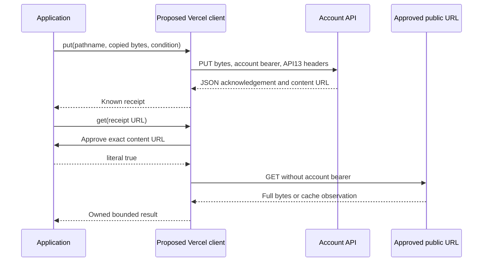

# Proposed Vercel Blob public-store client

This plan is for maintainers implementing the next `object-native` record. The pinned SDK/local-emulator fixture
passed on 2026-11-06; the in-progress `src/vercel.ts` client remains unqualified. No driver, adapter or hosted-provider
support is established. The historical `vercel-blob` catalog entry remains unchanged. Vercel Blob is distinct from
Vercel Runtime Cache and build caching; generic S3 support does not implement its native API.

An inert acquisition has now passed for 33 frozen test-only artifacts; the original receipt is
`897ff16b-b4d4-4a91-9b18-6ec0dfd6cc73`. The [fixture guide](../../tests/fixtures/vercel/README.md) records its exact
closure hash, notice review, import effects and source-ready qualification recipe. Fresh inert receipt
`3d0d790d-502f-4c51-9c56-9a1357b043af` also passed after strengthening third-party-notice indexing, with closure SHA-256
`d30d27e3cef8dad193541a3efb3c92cf231d5231e2fc34fbe1e03685135c73fc`. After separate owner admission for private test-only
execution, native attempt `a77da628-03f6-4e36-85c1-5c3c112896ec` completed its operations but failed an authored
assertion that incorrectly expected PUT receipt size. HEAD metadata supplies that separate size observation; the
corrected test subsequently passed with the read-only-root-filesystem restriction described below. A second attempt,
`940b5bb2`, failed before upstream imports because pre-start copying targeted Docker's read-only `/`. The source recipe
then bootstrapped the reviewed image, checked both bounded tmpfs mounts and attempted archive transport directly to
`/fixture`. Native attempt
`33b7877d` also failed: Docker archive extraction does not admit this legacy tmpfs destination under a read-only root.
The replacement source uses a fixed Node-built-in-only stdin writer, validates the complete bounded namespace and full
bytes before writes, verifies readback, and creates the ready marker last. Native receipt
`4e5f407c-b707-4c83-b4d9-42608d07943d` subsequently passed the SDK/literal-HTTP comparisons, including conditional
refusals, pagination and complete-byte readback. Its retained `receipt.json` and `output.log` are under
`.tmp/implementation/vercel-native/4e5f407c-b707-4c83-b4d9-42608d07943d/`; the log records a read-only root,
both 32 MiB tmpfs mounts, one passing test with one step, and clean retirement without OOM. All failed receipts remain
unchanged. This local fixture pass does not qualify the OPFS client, approve production dependencies or establish
hosted-provider behavior.

Start with one bounded public-store flow: the application supplies an API authority, store identity, read-write token,
Fetch and an approved content authority. It uploads copied bytes to one exact pathname, retains the acknowledgement,
then reads the returned public URL. A lost upload reply requires reconciliation before retry. The proposal deliberately
excludes private delivery, OIDC, image optimization, client-token generation and multipart upload from this first slice.
These are separate contracts, not implicit features of a method named `put`. Production implementation must use built-in
Web APIs and already approved standard/personal libraries only. The SDK, emulator, `jose` and their other transitive
packages are candidates for separately reviewed test tooling; this plan does not approve them as runtime dependencies.

## Freeze the identity before acquiring executable tooling

Primary registry/source research on 2026-11-06 found:

| Candidate                                                                                          | Exact identity                                                                      | Role and admission state                                                                       |
| -------------------------------------------------------------------------------------------------- | ----------------------------------------------------------------------------------- | ---------------------------------------------------------------------------------------------- |
| [`@vercel/blob`](https://registry.npmjs.org/@vercel/blob/2.8.2)                                    | 2.8.2, Apache-2.0, Node >=20; published root has ESM/CJS and `./client` entrypoints | Proposed test-only public SDK oracle; not a production dependency and not execution-admitted   |
| [SDK provenance](https://registry.npmjs.org/-/npm/v1/attestations/@vercel%2fblob@2.8.2)            | Source revision `5425e1611f65799a02ffa0033086a56e8d280dd5` in `vercel/storage`      | Registry metadata omitted `gitHead`; this revision comes from the decoded provenance statement |
| [`@emulators/vercel`](https://registry.npmjs.org/@emulators/vercel/0.13.0)                         | 0.13.0, Apache-2.0                                                                  | Proposed independently authored local service; not the production Vercel backend               |
| [Emulator provenance](https://registry.npmjs.org/-/npm/v1/attestations/@emulators%2fvercel@0.13.0) | Source revision `1566b8e38177bd606f1b4415b7da047ae653a8b7` in `vercel-labs/emulate` | Read the published revision, not current main `b75beb7ce7d78676d471fff47432b77be6ff6528`       |
| [`@emulators/core`](https://registry.npmjs.org/@emulators/core/0.13.0)                             | 0.13.0, Apache-2.0                                                                  | Exact dependency of the emulator; its `jose` edge still needs a frozen transitive closure      |

The root archive identities reported by the registry are:

```text
@vercel/blob@2.8.2
sha512-ZUUWO2VA00r9ZTRtKgH4va7FGOUxUtge2FaRr9WZmeeX2s3C3qVe2tOTLTbv/tkcd+L+ijxaI2eP9S1/mGHc9Q==

@emulators/vercel@0.13.0
sha512-3lzIfV4U1iYjnKPppHlZHB3Mxt0lsXqbSZNQw43dMr8uXHlu0IHr7TMn3kQuWn6yU1MwXo4Qjo2hSljur+H2UA==

@emulators/core@0.13.0
sha512-uh9Z2ZsxsmrHyZQHENRKXRImqTAbHCqrPWCzDSQ/OKwVsiJFZhNZOu1bm/h8jsRsFU5kISuOJcD9XNMP1afwlQ==
```

These are metadata observations. No archive was acquired or executed during this research, no Sigstore signature was
verified, and decoding a provenance statement does not prove its trust chain or a reproducible source build. The SDK's
declared runtime edges are `undici ^6.23.0`, `is-buffer ^2.0.5`, `throttleit ^2.1.0`, `async-retry ^1.3.3`,
`@vercel/oidc ^3.6.1` and `is-node-process ^1.2.0`. The emulator depends on exact `@emulators/core 0.13.0`, which
declares `jose ^6.2.2`. These ranges are discovery inputs, not an admitted lockfile. Freeze every actual runtime,
optional and peer edge, verify packed manifests/SRI and retain licenses/notices before importing any package. Do not
install workspace development tools, run lifecycle scripts, replace imports with stubs or infer the closure size.

## Separate the account API from public content delivery

The [public-storage documentation](https://vercel.com/docs/vercel-blob/public-storage) permits delivery through the
object's public URL without account authentication. Public delivery and its CDN/browser cache are different from control
operations. An overwrite acknowledgement does not prove that every public reader immediately sees new bytes. The first
profile must not promise strong read-after-write consistency, private access or cache invalidation.

The proposed literal profile is `vercel-blob-2.8.2-public-api13-v1`. It is a versioned SDK-wire compatibility choice,
not a claim that the SDK internals are a stable public REST standard. The pinned
[API code](https://github.com/vercel/storage/blob/5425e1611f65799a02ffa0033086a56e8d280dd5/packages/blob/src/api.ts)
uses API version 13 and defaults to `https://vercel.com/api/blob`; it supplies the account bearer, store ID and attempt
headers and can retry API requests. The proposed client instead takes an explicit API URL, store ID and token, sends one
attempt, and does not discover environment credentials or refresh them. Required request-ID/header formatting must be
frozen from SDK captures before coding; generated SDK IDs are not evidence of an idempotency guarantee.

The candidate must restrict its bearer to the exact configured API authority and route. Public content GETs carry no
account bearer, even if an application approves a content URL on that same origin. This public-read policy differs
deliberately from the SDK's authenticated `get` implementation. Require HTTPS, no userinfo/fragments, refused redirects
and explicit exact content-URL authorization. A fixture-only HTTP grant must not bypass authorization. Never accept a
hostname-suffix match as permission to send a credential to an arbitrary store.

The ordinary path is shown below. A pathname identifies the stored object; the receipt's URL identifies where public
content is served. Reading a URL is an explicit operation, not a hidden metadata lookup.



The diagram follows acknowledged requests. Each response must be retired before settlement. If the upload's reply is
lost, there is no receipt URL to invent; the application can inspect the original pathname through `head` and decide
whether the observed object satisfies its own publication intent. Concurrent writes and cache effects can still make
that reconciliation inconclusive.

## Implement only these first operations

| Proposed operation              | Pinned source contract                                                                                                                                                                                                             | Required first-profile restriction                                                                                                                                   |
| ------------------------------- | ---------------------------------------------------------------------------------------------------------------------------------------------------------------------------------------------------------------------------------- | -------------------------------------------------------------------------------------------------------------------------------------------------------------------- |
| `put(pathname, bytes, options)` | [put.ts](https://github.com/vercel/storage/blob/5425e1611f65799a02ffa0033086a56e8d280dd5/packages/blob/src/put.ts) sends raw bytes in `PUT /?pathname=...` and returns JSON with pathname, URLs, content type/disposition and ETag | Public access, copied bounded bytes, explicit content type, random suffix disabled; verify the acknowledged pathname equals the requested identity                   |
| `head(pathname)`                | [head.ts](https://github.com/vercel/storage/blob/5425e1611f65799a02ffa0033086a56e8d280dd5/packages/blob/src/head.ts) uses **GET**, with `url` query, because its response contains JSON metadata                                   | Preserve optional/validated observations; do not implement this as an HTTP HEAD or silently fetch object bytes                                                       |
| `list(options)`                 | [list.ts](https://github.com/vercel/storage/blob/5425e1611f65799a02ffa0033086a56e8d280dd5/packages/blob/src/list.ts) sends limit, prefix, cursor and mode; returns blobs, `hasMore` and optional cursor                            | One expanded page only initially, finite limit/entry cap; preserve opaque cursors and sizes/ETags without collecting later pages                                     |
| `delete(pathname, options)`     | [del.ts](https://github.com/vercel/storage/blob/5425e1611f65799a02ffa0033086a56e8d280dd5/packages/blob/src/del.ts) sends **POST `/delete`**, JSON `{urls:[...]}` and optional `x-if-match`                                         | Single original pathname only; deletion acknowledgement does not identify a deleted revision or prove lasting absence                                                |
| `get(url, options)`             | [get.ts](https://github.com/vercel/storage/blob/5425e1611f65799a02ffa0033086a56e8d280dd5/packages/blob/src/get.ts) reads a content URL, supports `ifNoneMatch`, returns a stream/metadata, null on 404 or a 304 variant            | Candidate owns a full bounded snapshot: only 200, final 404 or requested cache 304; no Range/206, caller headers, private bearer or inferred pathname-to-URL mapping |

The
[PUT header mapping](https://github.com/vercel/storage/blob/5425e1611f65799a02ffa0033086a56e8d280dd5/packages/blob/src/put-helpers.ts)
uses `x-vercel-blob-access`, `x-add-random-suffix`, `x-allow-overwrite`, `x-content-type` and `x-if-match`. Create-only
means the native overwrite option is false, not an invented standard `If-None-Match: *` header. An ETag match enables
overwrite; explicitly disabling overwrite at the same time is contradictory and must fail before I/O. Start with
ordinary ASCII segments, refuse dot/empty/percent/query/fragment/backslash ambiguities, and encode query parameters
exactly once. The SDK's 950-character pathname check is not a UTF-8 allocation budget or proof that all Unicode paths
preserve identity. Broader native names require independent write/read/list byte comparisons.

Do not translate a generic collision `400 bad_request` into an authoritative no-publication receipt by matching an
English error message. Qualify exact conditional/error codes and status combinations first. Preserve the provider's ETag
as an opaque observation; the emulator's SHA256-derived ETag does not make real Vercel ETags content authentication.
Caller metadata maps, copy/rename, folded-list projections and folders are outside this first slice.

## Bound work and make uncertain publication visible

Propose a 1 MiB payload/snapshot default, 64 KiB chunks, 64 KiB control JSON, 32 KiB response headers, 1,000 entries,
one Fetch invocation per primitive, bounded JSON depth/node count, a finite read-step cap and a 30-second operation
deadline. These are adjustable implementation safety limits, not provider quotas or exact heap accounting. Capture
constructor options without I/O; snapshot PUT bytes before awaiting foreign work; count bytes before refusing an
oversized chunk. Parse finite integer sizes and strict UTF-8 JSON without retaining response text in errors.

The injected Fetch is borrowed and must honor AbortSignal and avoid hidden mutation retries. The operation joins
transport/body retirement, releases locks and clears its own timer before settling; cancellation is not proof of
rollback. A dispatched PUT or POST-delete without an admitted completion is unknown. Preserve a known native
acknowledgement beside later parsing or cleanup failure. Freeze admissible success/error bodies from independent
captures before defining receipts; do not assume Netlify's empty-response or conditional-status rules apply here.
Reconciliation and any retry belong to the caller. Never log account tokens or signed URL queries in evidence.

## Use the emulator as an independent model, with explicit exclusions

The published
[Vercel Labs emulator](https://github.com/vercel-labs/emulate/tree/1566b8e38177bd606f1b4415b7da047ae653a8b7/packages/%40emulators/vercel)
is a feasible local fixture candidate. Its public plugin and core server/store exports allow a small authored launcher;
its own SDK tests show loopback binding, the SDK's `VERCEL_BLOB_API_URL` override and returned local content URLs. Use
the published entrypoints, not private route imports, and keep any SDK environment override inside that disposable test
process. The source tests used SDK 2.8.1; interoperability with the selected 2.8.2 must be proved, not assumed.

Its implementation imposes important proof limits:

- [Content delivery](https://github.com/vercel-labs/emulate/blob/1566b8e38177bd606f1b4415b7da047ae653a8b7/packages/%40emulators/vercel/src/routes/blob/content.ts)
  is public and does not enforce private authentication. It handles cache 304, but does not qualify guarded ranges.
- [Authentication](https://github.com/vercel-labs/emulate/blob/1566b8e38177bd606f1b4415b7da047ae653a8b7/packages/%40emulators/vercel/src/routes/blob/auth.ts)
  primarily extracts a store ID from token syntax or a header. It cannot prove production token authenticity, scope or
  OIDC verification.
- [Listing](https://github.com/vercel-labs/emulate/blob/1566b8e38177bd606f1b4415b7da047ae653a8b7/packages/%40emulators/vercel/src/routes/blob/head-list.ts)
  uses lexicographic keys as cursors. Preserve those observations without promising the production cursor encoding,
  concurrent-pagination consistency or ordering.
- [Multipart](https://github.com/vercel-labs/emulate/blob/1566b8e38177bd606f1b4415b7da047ae653a8b7/packages/%40emulators/vercel/src/routes/blob/multipart.ts)
  creates a session but explicitly refuses part upload/completion. Session creation alone cannot qualify multipart
  support.

After dependency admission, use Testcontainers with a pinned Node image, no external execution-time network, one CPU, 1
GiB memory/swap, 256 PIDs, bounded tmpfs/logs/Node heaps and effective-limit readback. Bind only inside the private
namespace, await the public server listening/close APIs, and retain primary plus cleanup failures. Admit a separately
hashed standalone candidate bundle. This is test tooling, never a production dependency or global SDK substitution.

Compare complete empty and 128 KiB authored bytes through SDK→candidate and candidate→SDK paths. Check metadata lookup,
actual pathname identity, new-only collision, stale/current guards, list prefix and two pages, deletion, public-read
bearer omission, API bearer confinement and unauthorized content URLs refused before dispatch. Add an explicit
lost-final-reply control and read back complete bytes through the other client. Preserve local-model differences rather
than modifying the emulator or weakening expectations to imitate production claims.

An authored HTTP peer can independently cover malformed JSON, truncation, redirected responses, quota overruns,
pre-abort, late abort, body cancellation, lock release and known/unknown receipts. It is useful unit evidence but cannot
replace the emulator/SDK comparison. Neither local route proves actual Vercel durability, authorization, caching, rate
limits, race atomicity, billing behavior or live compatibility. No live credentials or paid resources are supplied or
requested for this initial local plan; a later live gate needs a caller-owned disposable store/prefix and explicit
authority.

## Keep streaming, resumption and filesystem projection separate

Returning a `ReadableStream` is incremental consumption with backpressure, not a persisted resume checkpoint. The first
GET still owns a bounded complete snapshot. Exposing a stream later needs explicit byte/step/deadline budgets,
early-return cancellation and a clear owner after the method returns. Archive preview additionally needs verified 206
extents and an enforced immutable identity; cache `If-None-Match` and a full public GET do not establish that.

The SDK exposes
[multipart creation](https://github.com/vercel/storage/blob/5425e1611f65799a02ffa0033086a56e8d280dd5/packages/blob/src/multipart/create.ts)
with key/uploadId and
[part upload](https://github.com/vercel/storage/blob/5425e1611f65799a02ffa0033086a56e8d280dd5/packages/blob/src/multipart/upload.ts)
with one-based part numbers and ETags, followed by completion. This is a distinct upload protocol, not TUS. The
inspected public exports do not establish part listing, remote acknowledged-offset recovery, expiration or abort
cleanup. Persistent restart requires those contracts, retained per-part receipts and identity-bound reconciliation after
a lost part/completion reply. The emulator cannot qualify that continuation. Do not advertise resumable writes from
multipart method names or SDK automatic retries.

The test-only closure acquisition and local SDK/emulator qualification above are complete for their exact retained
inputs. Next, freeze the source-compatible wire profile and outcome schemas, finish and qualify the bounded portable
client, run authored and reciprocal controls, then verify packed consumers and CI. Only then consider a driver whose
inspection explains native sizes, cursors, conditional writes and missing guarded reads. An adapter translating into
`FileSystemType` is a later semantic decision. No nominal ObjectDriver, range source, mount or bridge completes this
catalog record, and the broader object-native group remains pending.

The retained native fixture closes the local SDK2.8.2/emulator0.13.0 exchange gate for the exercised public entrypoints,
headers, response bodies, statuses and condition failures. Carry those independent observations into the OPFS client
qualification; generic errors still do not prove rollback.
The SDK's automatic retry means its final error alone cannot settle whole-call publication history. Private credential
validation, multipart completion/recovery and real provider behavior remain later authority/qualification gaps even if
all of the public local-model checks pass. The original planning slice performed no implementation or execution;
this status update records the later retained fixture result, not a new run or a client qualification.
