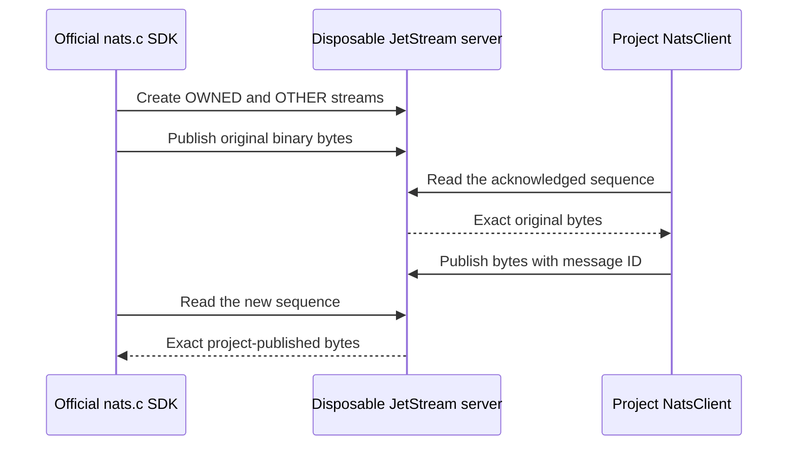

# Independent NATS fixture

The provider test checks the project JetStream client against NATS Server and the official native C SDK. A native
publisher seeds exact binary bytes, the project reads them, the project publishes more bytes, and the native reader
retrieves those same sequence numbers. A separate stream verifies that a rejected expected-stream publish did not write
into the wrong stream. This fixture does not test KV buckets, watches, clustering, TLS, NKeys or reconnects.

Run `deno task test:nats-provider` with Docker available. Testcontainers builds `Dockerfile`, creates a private network
and starts the server and native SDK oracle. No prepared image or wheel environment variable is needed. The inherited
Node image is pinned by digest. Its signed Debian repositories supply `libnats-dev` and `g++` during the build; no
package acquisition occurs in the running oracle. The build records exact archive SHA-256s, installed package/source
versions, signed InRelease files, APT sources, compiler identity, harness/binary/header hashes and copyright notices
under `/oracle/receipts`. `oracle.cpp` calls the public native APIs directly. It does not import project code.

The server retains the existing 8 MiB memory/file limits, two 4 MiB/64-message streams and 1 MiB per-message limit. The
server and oracle each have 256 MiB RAM, no swap, half a CPU and 128 PIDs; pre-start and running-state admission checks
retain those constraints. Only the server owns a bounded 16 MiB tmpfs. The caller owns no service credentials: the
fixture creates disposable local users. The oracle uses no reconnect and five-second native connection/request timeouts;
each native command has a twenty-second outer timeout. Input bytes and decoded replies remain bounded.

Native init receipts report the **actual** linked `nats_GetVersion()` value. The inspected public contract is the
[official v3.4.1 header](https://github.com/nats-io/nats.c/blob/v3.4.1/src/nats.h), matching the
[bookworm package family](https://packages.debian.org/bookworm/libnats-dev). The package closure and actual run receipt
remain authoritative if the signed distribution changes. The fixture does not relabel a newer package as 3.4.1.

`provider.ts.snapshot` preserves the entire previous active fixture, including its Python SDK program, byte for byte:
SHA-256 `091f4ec3c3fcf5da75fc6a0ea527ee7cef3b41eae707d816796771cf3869e58b`. The old `provenance.json`, wheel metadata,
capture files, tests and benchmark receipts describe that earlier Python execution. They remain unchanged. They are not
evidence that the native replacement ran. New provider output must retain its own native SDK version, package/build
receipt and resource checks before claiming qualification. The current native provider case passed its selected
full-byte, duplicate, stream-isolation and authentication controls; this does not change the historical capture or
benchmark provenance.
